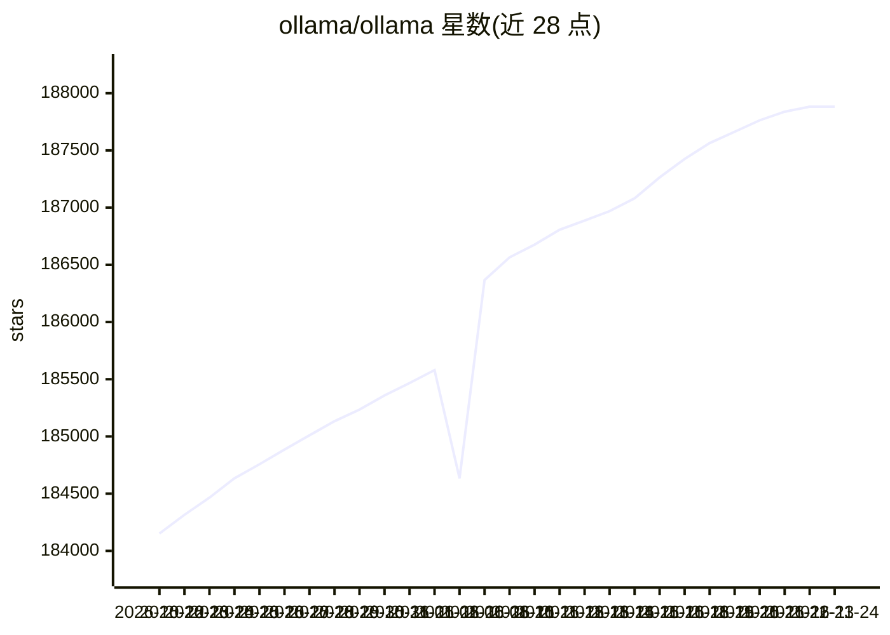

# ollama/ollama

⭐ 187,915 · Go · MIT · 推送 2026-11-24 · [GitHub](https://github.com/ollama/ollama) · [官网](https://ollama.com) · 组织维护

**本地/云端运行开源大模型的推理工具，提供 CLI 与 REST API**

Ollama 提供本地与云端运行开源模型（Gemma、DeepSeek、Qwen 等）的运行时，通过安装脚本覆盖 macOS/Windows/Linux，官方 Docker 镜像可容器化部署。核心机制包括：ollama run/launch 命令行启动模型、REST API（localhost:11434）运行与管理模型、官方 Python/JavaScript SDK，以及基于 llama.cpp 的推理后端。文档另收录大量第三方客户端、框架与 SDK 的社区集成清单。

## 筛选速览

| 维度 | 判定 | 备注 |
|---|---|---|
| AI 角色 | `ai-ecosystem` | LLM/agent 周边工具 |
| 许可风险 | `permissive` | MIT |
| 部署形态 | `library` | 以包/库形式分发 |
| 模型依赖 | — | README 未给出锁定关系 |
| 硬件要求 | — | 无带数字的原话,不猜 |
| 安装摩擦 | `low` | 无编译、无系统依赖或容器化 |
| 成熟度 | — | 结构信号不足 |

## 动量与使用信号

- 维护:`active` — 距上次 push 1.2 天,年发版 100,447 位贡献者
- 涨星:近 1 天 **+202**(自 20261016 起算)
- 安装:pypi 包 `ollama` 月下载 13,275,724
- 平台:WINDOWS / MACOS / LINUX / WEB · 协议:OLLAMA

## 能力要点

- 一条命令运行模型并与 Claude Code、Copilot 等工具集成（ollama launch）
- REST API 与官方 Python/JavaScript SDK（pip/npm 安装）
- 基于 llama.cpp 的推理后端，官方 Docker 镜像 ollama/ollama
- 维护覆盖聊天界面、编辑器、RAG、Agent 等类别的社区集成清单

## 适用场景

- 在本机隐私环境下运行开源大模型
- 为自建 Agent/应用提供本地模型推理后端
- 通过 REST API 将模型接入现有工作流

## 场景标签

`推理引擎` · 领域:训练与推理

## 证据(README 行号)

> L86: Ollama has a REST API for running and managing models.
> L123: ## Supported backends

## 星数曲线

2026-10-22 184,151 → 2026-11-24 187,882（+3,731）

---
*卡片 v1 · prompt 1.4 · 生成 2026-11-22 · 置信度 high · 依据 README sha `0b766a71b26a` · [字段定义](../../DATASET.md)*
