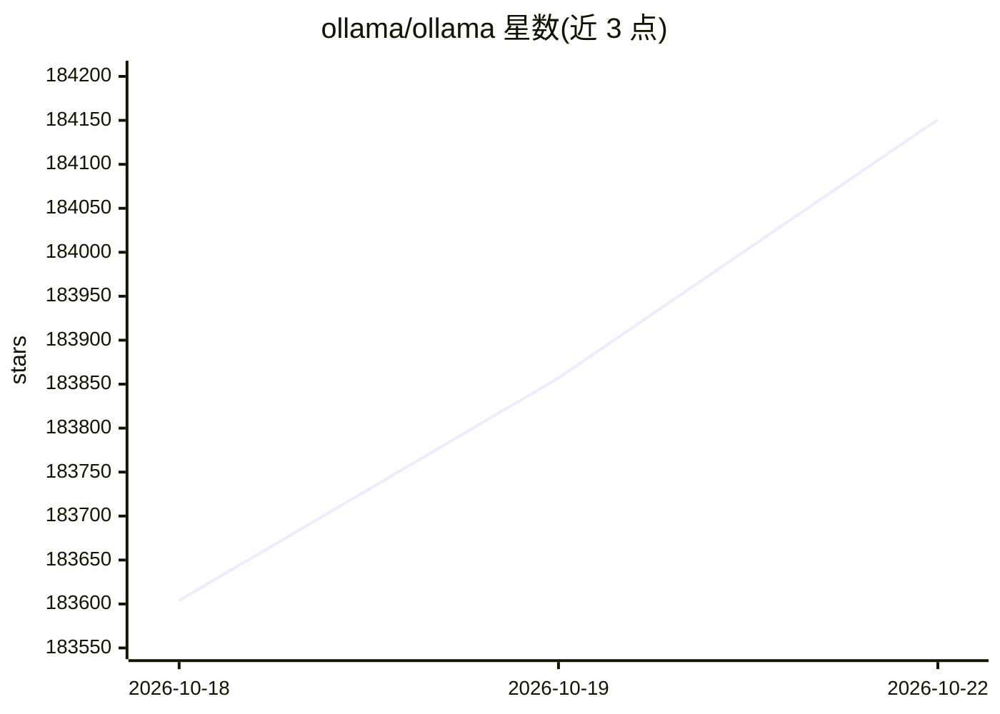

# ollama/ollama

⭐ 184,151 · Go · MIT · 推送 2026-10-21 · [GitHub](https://github.com/ollama/ollama) · [官网](https://ollama.com) · 组织维护

**本地与云端运行开源大模型的工具：下载即用多款开放模型**

Ollama 是一个用于在本地或云端运行开源大模型的工具，覆盖下载安装、命令行交互、模型管理和 REST API。支持 macOS、Windows、Linux 的脚本安装与 Docker 官方镜像，提供 Python、JavaScript 官方库；可配合 Claude Code、Codex、Copilot CLI 等编码集成运行，并通过 OpenClaw 接入多平台消息渠道作为 AI 助手。后端基于 llama.cpp 项目。

## 筛选速览

| 维度 | 判定 | 备注 |
|---|---|---|
| AI 角色 | `ai-native` | 本体是模型或模型工具 |
| 许可风险 | `permissive` | MIT |
| 部署形态 | `library` | 以包/库形式分发 |
| 模型依赖 | local-ok | 支持本地模型 |
| 硬件要求 | — | 无带数字的原话,不猜 |
| 安装摩擦 | `low` | 无编译、无系统依赖或容器化 |
| 成熟度 | — | 结构信号不足 |

## 动量与使用信号

- 维护:`active` — 距上次 push 1.2 天,年发版 100,447 位贡献者
- 涨星:近 1 天 **+202**(自 20261016 起算)
- 安装:pypi 包 `ollama` 月下载 13,275,724
- 平台:WINDOWS / MACOS / LINUX / WEB · 协议:OLLAMA

## 能力要点

- 提供 REST API 与 Python/JavaScript 官方库（pip/npm 安装）
- 支持 macOS/Windows/Linux 脚本安装与官方 Docker 镜像
- 支持编码集成（Claude Code、Codex、Copilot CLI 等）与 OpenClaw 助手接入
- 模型后端基于 llama.cpp 项目

## 适用场景

- 在本地或云端下载并运行开源大模型
- 通过 REST API 或 SDK 将模型接入自己的应用
- 将模型接入 Claude Code、Copilot CLI 等编码工具
- 搭建多平台消息渠道的 AI 助手

## 场景标签

`推理引擎` · 领域:训练与推理

## 证据(README 行号)

> L5: # Ollama
> L7: Start building with open models. Access the latest releases locally or in the cloud with complete privacy.
> L86: Ollama has a REST API for running and managing models.

## 星数曲线

2026-10-18 183,604 → 2026-10-22 184,151（+547）

---
*卡片 v1 · prompt 1.4 · 生成 2026-10-18 · 置信度 high · 依据 README sha `043c4d0499fb` · [字段定义](../../DATASET.md)*
