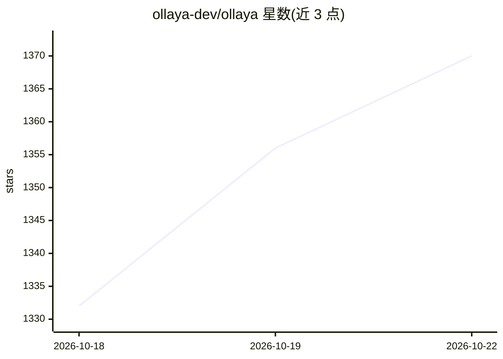

# ollaya-dev/ollaya

⭐ 1,380 · Rust · Apache-2.0 · 推送 2026-10-22 · [GitHub](https://github.com/ollaya-dev/ollaya) · [官网](https://ollaya.dev) · 个人维护

**本地运行开源决策模型的运行时：按名拉取并通过类 Ollama CLI/API 服务**

面向决策模型（decision models）的本地推理运行时：读取状态（消息/邮件/ticket/JSON）与类型化问题（choice/score/noul），单次前向返回校准概率，不生成文本。以单一二进制提供 daemon 与 run/pull/list 等 CLI，暴露与 TypeSafe 线格式兼容的 API 及原生 /api/decide。推理后端为 ONNX Runtime（CPU/CUDA）与 llama.cpp（GGUF 模型）。权重不重托管，从作者 Hugging Face 仓库按 commit 校验读取。提供 Linux/macOS/Windows 安装脚本、桌面应用与 Docker 镜像。

## 筛选速览

| 维度 | 判定 | 备注 |
|---|---|---|
| AI 角色 | `ai-ecosystem` | LLM/agent 周边工具 |
| 许可风险 | `permissive` | Apache-2.0 |
| 部署形态 | `self-host` | docker 或自建部署 |
| 模型依赖 | local-ok | 支持本地模型 |
| 硬件要求 | `cpu-ok` | |
| 安装摩擦 | `low` | 无编译、无系统依赖或容器化 |
| 成熟度 | — | 结构信号不足 |

## 能力要点

- 单二进制 daemon + 类 Ollama CLI（run/pull/create 等）
- TypeSafe 兼容 API（/v1/systemone、/v1/decisions）与原生 /api/decide
- ONNX Runtime 与 llama.cpp 双后端，覆盖 CPU/CUDA/Vulkan/Metal
- 通过 ollaya mcp 向 Claude Code/Cursor 等 MCP 客户端提供模型

## 适用场景

- 在本地对工单、邮件等状态做类型化决策与打分
- 让 Claude Code 等 agent 客户端调用本地决策模型
- 用 Modelfile 把问题集固化成自定义模型并分发

## 场景标签

`推理引擎` · 领域:训练与推理

## 证据(README 行号)

> L16: milliseconds. It never generates text. Ollaya pulls these models by name, serves them from a
> L39: - **One binary.** `ollaya serve` runs the daemon; `ollaya run`, `pull`, `list`, `ps`, `show`, `rm`,
> L42: - **TypeSafe-compatible.** `POST /v1/systemone`, `/v1/decisions` and `GET /v1/models` are

## 星数曲线

2026-10-18 1,332 → 2026-10-22 1,370（+38）

---
*卡片 v1 · prompt 1.4 · 生成 2026-10-21 · 置信度 mid · 依据 README sha `afc5f809d853` · [字段定义](../../DATASET.md)*
