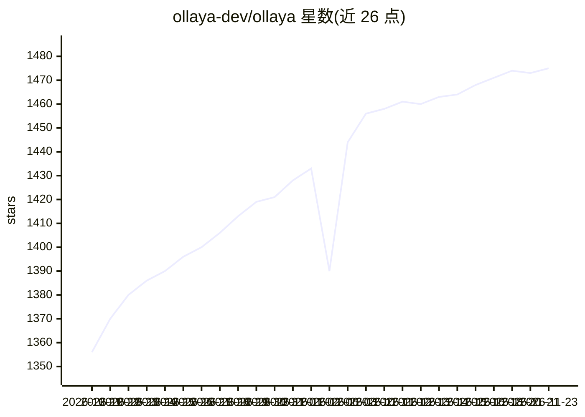

# ollaya-dev/ollaya

⭐ 1,475 · Rust · Apache-2.0 · 推送 2026-11-21 · [GitHub](https://github.com/ollaya-dev/ollaya) · [官网](https://ollaya.dev) · 个人维护

**本地运行开源决策模型、兼容 Jev API 的推理服务器**

以类 Ollama 的方式在自有硬件上拉取并服务 29 个开源决策模型家族：读取状态与类型化问题（choice/score/noul），单次前向返回校准概率，不生成文本。提供 TypeSafe Jev 兼容的 /v1/systemone 等 wire 格式接口，SDK 改 base URL 即可接入；带 CLI（serve/run/pull/create 等）、MCP server、Modelfile 与本地校准命令。权重从作者 Hugging Face 仓库读取并校验 sha256，不重新托管。个人维护，Apache-2.0。

## 筛选速览

| 维度 | 判定 | 备注 |
|---|---|---|
| AI 角色 | `ai-ecosystem` | LLM/agent 周边工具 |
| 许可风险 | `permissive` | Apache-2.0 |
| 部署形态 | `self-host` | docker 或自建部署 |
| 模型依赖 | local-ok | 支持本地模型 |
| 硬件要求 | — | 无带数字的原话,不猜 |
| 安装摩擦 | `low` | 无编译、无系统依赖或容器化 |
| 成熟度 | — | 结构信号不足 |

## 能力要点

- 单二进制 CLI：serve/run/pull/create/calibrate 等子命令
- TypeSafe SDK 与 Jev 客户端指向 Ollaya 后无需改动
- ollaya mcp 服务于 Claude Code、Claude Desktop、Cursor 等 MCP 客户端
- ollaya calibrate 在本机数据上按媒体与问题类型拟合温度并报告 NLL/ECE

## 适用场景

- 为 agent 提供无需 LLM 调用的路由、护栏、工单分诊与工具审批判定
- 自托管替换 TypeSafe Jev 托管 API，数据不出本机
- 已有 TypeSafe SDK/Jev 客户端迁移到开源决策模型

## 场景标签

`推理引擎` · 领域:训练与推理

## 证据(README 行号)

> L5:  Ollaya runs open decision models on your own hardware, the way Ollama runs LLMs. Typed questions in, calibrated ans
> L19: local daemon behind a self-hosted, Jev-compatible API (TypeSafe's `/v1/systemone` wire format),
> L84: - **For agents.** `ollaya mcp` serves the models to Claude Code, Claude Desktop, Cursor and other

## 星数曲线

2026-10-21 1,356 → 2026-11-23 1,475（+119）

---
*卡片 v1 · prompt 1.4 · 生成 2026-11-23 · 置信度 mid · 依据 README sha `c5a53e3751b4` · [字段定义](../../DATASET.md)*
