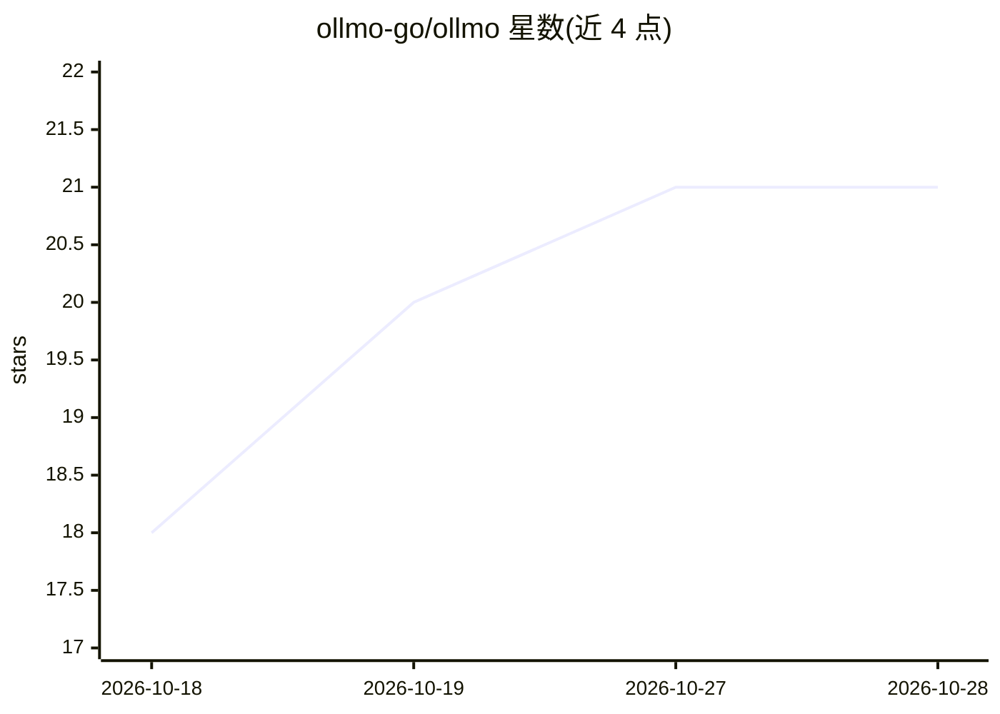

# ollmo-go/ollmo

⭐ 21 · Go · NOASSERTION · 推送 2026-08-24 · [GitHub](https://github.com/ollmo-go/ollmo) · [官网](https://ollmo.com) · 组织维护 · 中文 README

**私有部署的生产级 RAG 平台：文档变可对话的知识库助手**

用 Go + Fiber 后端与 Next.js 前端构建的开源 RAG 平台，流程为上传文档→解析分块→嵌入索引→带引用的流式问答。支持混合检索（语义+关键词、可调权重与重绘）、多租户隔离（MySQL/Milvus/MinIO）、可视化 Agent 编排画布与摄入管道画布、GraphRAG、执行回放、自动记忆、团队用量计费与外部 API。依赖 Docker Compose 启动 MySQL、Redis、MinIO、Milvus 等基础设施，可全栈一键部署，安装向导默认接入 SiliconFlow 的 DeepSeek 模型。

## 筛选速览

| 维度 | 判定 | 备注 |
|---|---|---|
| AI 角色 | `ai-native` | 本体是模型或模型工具 |
| 许可风险 | `none` | NOASSERTION |
| 部署形态 | `self-host` | docker 或自建部署 |
| 模型依赖 | locked-api |  |
| 硬件要求 | — | 无带数字的原话,不猜 |
| 安装摩擦 | `low` | 无编译、无系统依赖或容器化 |
| 成熟度 | — | 结构信号不足 |

## 能力要点

- 混合检索（语义+关键词融合，KB 级 rerank 与权重滑块测试）
- 可视化 Agent 画布：意图分类→检索→条件分支→LLM，带逐节点调试与执行回放
- 多租户隔离与团队级 token/成本核算、按用户配额
- GraphRAG 摄入期实体关系抽取，查询时增强检索上下文
- 知识库备份导入导出 JSON，导入后自动重建索引

## 适用场景

- 企业私有化部署基于内部文档的问答助手
- 团队按知识库管理文档问答并核算用量成本
- 通过画布编排检索与对话管道并逐节点调试

## 场景标签

`RAG` `文档问答` `聊天机器人` `知识库管理` · 领域:对话与助手

## 证据(README 行号)

> L7: A production-grade RAG platform with hybrid retrieval, multi-tenancy, and streaming chat.
> L43: - **Streaming Chat** — Real-time streaming with source citations, follow-up suggestions, and multi-device stream sy
> L151: 2. Seeds a SiliconFlow provider with LLM (DeepSeek-V4-Flash), embedding (BGE-Large-ZH), and rerank (BGE-Reranker-V

## 星数曲线

2026-10-18 18 → 2026-10-28 21（+3）

---
*卡片 v1 · prompt 1.4 · 生成 2026-10-28 · 置信度 high · 依据 README sha `e5c10bcb341c` · [字段定义](../../DATASET.md)*
