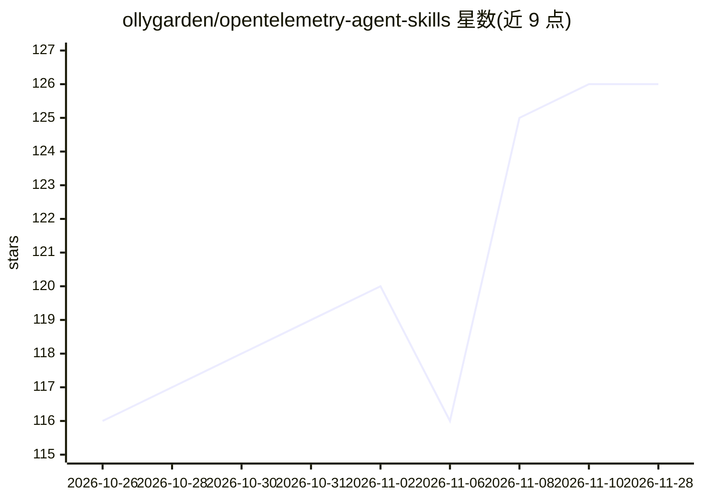

# ollygarden/opentelemetry-agent-skills

⭐ 126 · Go · Apache-2.0 · 推送 2026-11-27 · [GitHub](https://github.com/ollygarden/opentelemetry-agent-skills) · [官网](https://ollygarden.com/resources/agent-skills) · 组织维护

**给 AI 编码代理提供准确 OpenTelemetry 知识的技能集**

面向 Claude Code、Cursor、Codex、GitHub Copilot 等编码代理的开源 Agent Skills 集合，内容覆盖 Go/Java/JavaScript/Python/.NET/Ruby/浏览器的 SDK 配置、Collector 配置与 OTTL、语义约定及升级评估，共 20 余个技能，遵循 agentskills.io 规范。设计上不做约定规定，通过小型查找表、索引和指向上游事实来源的脚本实现 token 高效检索，使答案随上游项目演进保持最新。

## 筛选速览

| 维度 | 判定 | 备注 |
|---|---|---|
| AI 角色 | `ai-knowledge` | 知识聚合/清单类 |
| 许可风险 | `permissive` | Apache-2.0 |
| 部署形态 | `desktop` | 安装包/桌面程序 |
| 模型依赖 | — | README 未给出锁定关系 |
| 硬件要求 | — | 无带数字的原话,不猜 |
| 安装摩擦 | `medium` | 含编译或系统依赖之一 |
| 成熟度 | — | 结构信号不足 |

## 能力要点

- 20+ 个技能覆盖 SDK 配置、Collector、OTTL、语义约定、升级与迁移等主题
- 遵循 Agent Skills 规范，可被任何支持该规范的代理使用
- 通过查找表与上游来源指针实现 token 高效检索
- 支持 skills.sh、Claude Code 插件市场与 npm 包三种安装方式

## 适用场景

- 让编码代理在接入 OpenTelemetry 时获得最新的 SDK 配置指导
- 配置或调试 OpenTelemetry Collector 与 OTTL 转换规则
- 评估 OpenTelemetry 包和 Collector 的升级风险
- 按语义约定检查遥测命名合规性

## 场景标签

`编码 Agent` · 领域:编码与开发

## 证据(README 行号)

> L6: OllyGarden Agent Skills for OpenTelemetry are open source skills that give coding agents such as Claude Code, Cursor
> L10: They are designed for **token-efficient, agent-friendly retrieval**: small fetch tables, lookup indexes, and script

## 星数曲线

2026-10-26 116 → 2026-11-28 126（+10）

---
*卡片 v1 · prompt 1.4 · 生成 2026-11-28 · 置信度 high · 依据 README sha `2bd3c2eb1fbc` · [字段定义](../../DATASET.md)*
