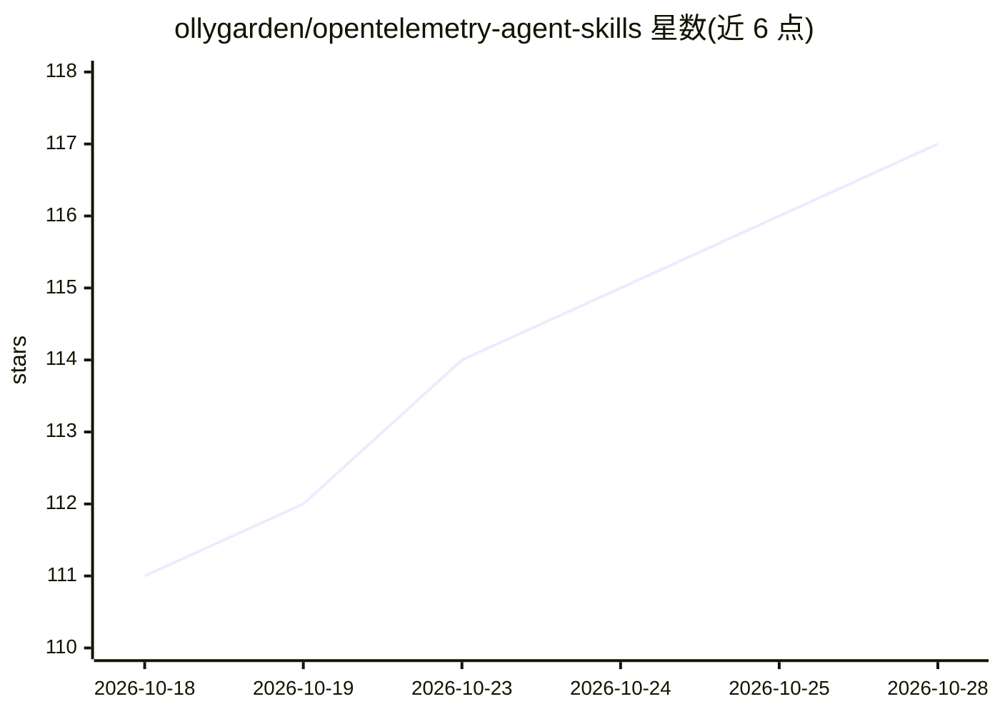

# ollygarden/opentelemetry-agent-skills

⭐ 117 · Go · Apache-2.0 · 推送 2026-10-28 · [GitHub](https://github.com/ollygarden/opentelemetry-agent-skills) · [官网](https://ollygarden.com/resources/agent-skills) · 组织维护

**给 AI 编码 agent 的厂商中立 OpenTelemetry 技能知识包**

遵循 Agent Skills 规范的 OpenTelemetry 技能集合，供 Claude Code、Cursor、Codex、GitHub Copilot 等编码 agent 使用。提供 9 个语言无关技能（Collector 配置、OTTL、语义约定、升级评估、Weaver 等）和 7 个语言专属技能（Go/Java/JS/Python/.NET/Ruby/浏览器），内容指向上游权威来源而非复制文档，设计为省 token 的检索方式（小规模 fetch 表、索引与脚本）。声明非观点化：不规定 OpenTelemetry 使用惯例。通过 skills CLI（npx）或 Claude Code 插件市场安装，仅覆盖 OpenTelemetry 领域。

## 筛选速览

| 维度 | 判定 | 备注 |
|---|---|---|
| AI 角色 | `ai-knowledge` | 知识聚合/清单类 |
| 许可风险 | `permissive` | Apache-2.0 |
| 部署形态 | `library` | 以包/库形式分发 |
| 模型依赖 | — | README 未给出锁定关系 |
| 硬件要求 | — | 无带数字的原话,不猜 |
| 安装摩擦 | `medium` | 含编译或系统依赖之一 |
| 成熟度 | — | 结构信号不足 |

## 能力要点

- 16 个技能：9 个语言无关 + 7 个语言专属（Go/Java/JS/Python/.NET/Ruby/浏览器）
- 遵循 agentskills.io 规范，兼容任何支持该规范的 agent
- 技能内容指向上游来源（fetch 表、索引、查询脚本），不复制文档进上下文
- 支持 npx skills CLI 一键安装全部或单个技能，或经 Claude Code 插件市场安装

## 适用场景

- 让编码 agent 在项目中正确配置 OpenTelemetry SDK 与 Collector
- 编写或审查 OTTL 语句、排查 Collector 组件配置问题
- 评估跨生态的 OpenTelemetry SDK/Collector 升级与兼容性
- 从废弃的 Span Event API 迁移到 Logs API

## 场景标签

`教程课程` · 领域:学习与行业

## 证据(README 行号)

> L6: OllyGarden Agent Skills for OpenTelemetry are open source skills that give coding agents such as Claude Code, Cursor
> L10: They are designed for **token-efficient, agent-friendly retrieval**: small fetch tables, lookup indexes, and script

## 星数曲线

2026-10-18 111 → 2026-10-28 117（+6）

---
*卡片 v1 · prompt 1.4 · 生成 2026-10-23 · 置信度 high · 依据 README sha `629b919a6c15` · [字段定义](../../DATASET.md)*
