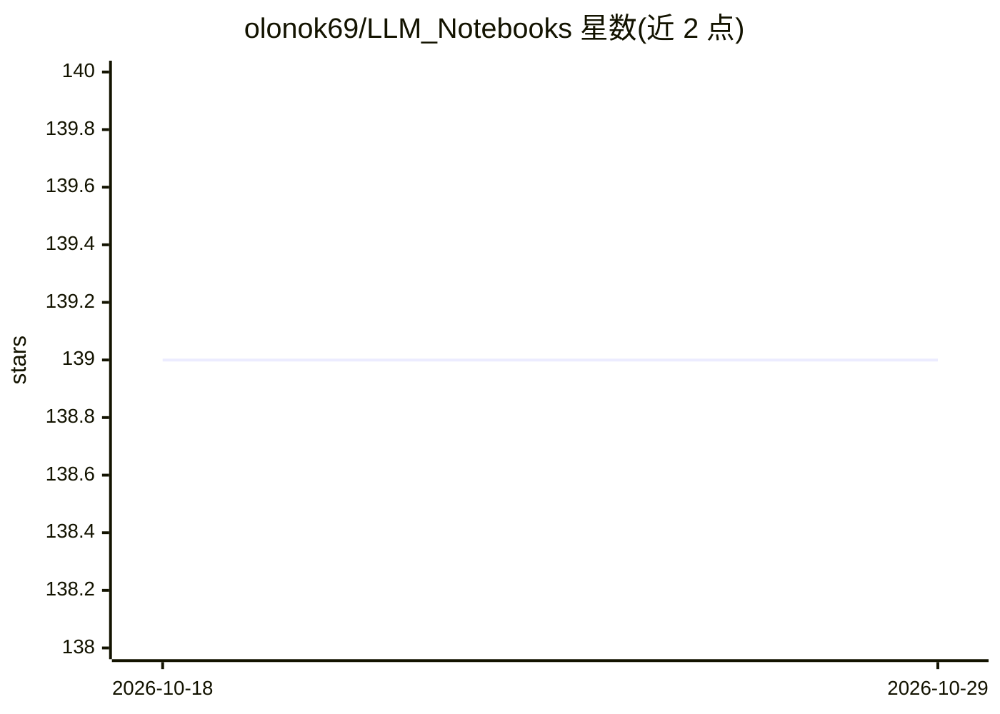

# olonok69/LLM_Notebooks

⭐ 139 · Jupyter Notebook · 推送 2026-10-18 · [GitHub](https://github.com/olonok69/LLM_Notebooks) · [官网](https://www.youtube.com/channel/UCqAi1lTsd2wj7p05-Oos4ug) · 个人维护

**生成式 AI/LLM/MLOps 教学 notebook 集合，配套 YouTube 频道视频**

个人维护的教程代码仓库，配套其 YouTube 频道 The Machine Learning Engineer 的视频内容：按主题（LangChain、LlamaIndex、RAG、MLOps、Databricks、Computer Vision、Neo4j、Microsoft/Google AI 等）组织成播放列表，每个视频对应仓库中的 Jupyter Notebook 或 VSCode 代码，以 Python 为主、含少量 C#，视频提供英语与西班牙语双版本。README 为播放列表索引，不含 issue 支持（作者声明仅通过 YouTube 评论答疑），仓库本身无统一安装说明。

## 筛选速览

| 维度 | 判定 | 备注 |
|---|---|---|
| AI 角色 | `ai-knowledge` | 知识聚合/清单类 |
| 许可风险 | `none` | — |
| 部署形态 | `None` |  |
| 模型依赖 | — | README 未给出锁定关系 |
| 硬件要求 | — | 无带数字的原话,不猜 |
| 安装摩擦 | `low` | 无编译、无系统依赖或容器化 |
| 成熟度 | — | 结构信号不足 |

## 能力要点

- 覆盖 LangChain（51 视频）、MLOps（100 视频）、RAG（27 视频）等多个主题的配套 notebook 与代码
- 英语与西班牙语双语言视频版本
- 主题含生成式 AI/LLM、CV、NLP、MLOps、Databricks、Neo4j 图数据科学

## 适用场景

- 跟着视频课程动手学 LLM/MLOps/RAG 相关技术
- 按主题查找某个具体技术的示例代码
- 西班牙语用户学习机器学习工程内容

## 场景标签

`教程课程` · 领域:学习与行业

## 证据(README 行号)

> L3: This Repository contains all material supporting the Videos in my YouTube channel The Machine Learning Engineer http
> L34: - Generative AI, LLM,s, Transformers, CV, NLP and more — 212 videos. YouTube

## 星数曲线

2026-10-18 139 → 2026-10-29 139（+0）

---
*卡片 v1 · prompt 1.4 · 生成 2026-10-27 · 置信度 high · 依据 README sha `532e7bcb8bd0` · [字段定义](../../DATASET.md)*
