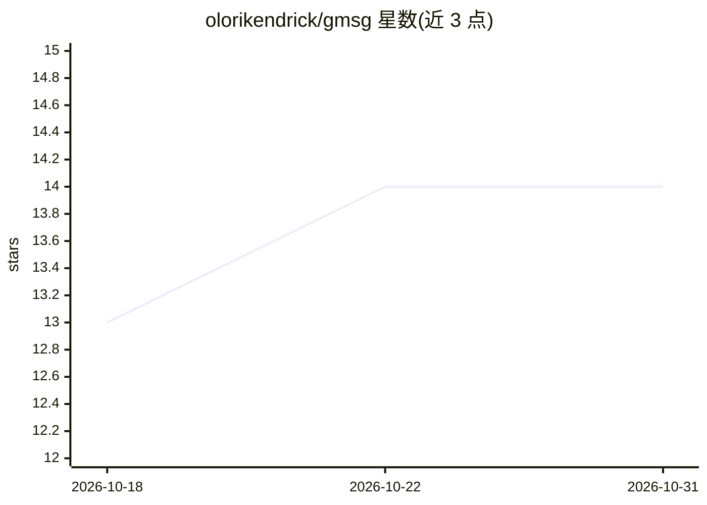

# olorikendrick/gmsg

⭐ 14 · Rust · MIT · 推送 2026-07-27 · [GitHub](https://github.com/olorikendrick/gmsg) · [官网](https://olorikendrick.github.io/gmsg/) · 个人维护

**用 LLM 从 staged diff 生成 Conventional Commits 的 Rust CLI**

Rust 编写的命令行工具：读取当前 git 仓库的 staged diff，调用所选 LLM（Gemini/Mistral/Groq）按 Conventional Commits 规范生成提交信息，可交互编辑后提交、复制到剪贴板或 amend 上一次提交。默认零配置，通过 config 子命令选择提供商/模型与自定义 system prompt。自建 reqwest 客户端不依赖框架，git 操作用 git2-rs，TUI 用 ratatui；支持 Android/Termux 运行。API key 需自行设置。

## 筛选速览

| 维度 | 判定 | 备注 |
|---|---|---|
| AI 角色 | `ai-native` | 本体是模型或模型工具 |
| 许可风险 | `permissive` | MIT |
| 部署形态 | `library` | 以包/库形式分发 |
| 模型依赖 | locked-api |  |
| 硬件要求 | — | 无带数字的原话,不猜 |
| 安装摩擦 | `low` | 无编译、无系统依赖或容器化 |
| 成熟度 | — | 结构信号不足 |

## 能力要点

- 以 Conventional Commits 规范为 system prompt 生成提交信息
- Gemini/Mistral/Groq 三家提供商可选，每家支持模型选择
- Ratatui 交互式 TUI 审阅编辑后再提交
- 支持 Android/Termux 原生运行（含剪贴板）

## 适用场景

- 写提交信息时让 AI 按 Conventional Commits 规范代笔
- 提交前用 TUI 审阅并修改 AI 生成的信息
- 在手机 Termux 环境生成提交信息

## 场景标签

`AI 写作` · 领域:内容生成

## 证据(README 行号)

> L8: **AI-powered utility for generating conventional Git commit messages.**
> L10: `gmsg` is a high-performance CLI tool built in Rust for generating commit messages. It uses AI to analyze your stag

## 星数曲线

2026-10-18 13 → 2026-10-31 14（+1）

---
*卡片 v1 · prompt 1.4 · 生成 2026-10-31 · 置信度 high · 依据 README sha `689401eef25f` · [字段定义](../../DATASET.md)*
