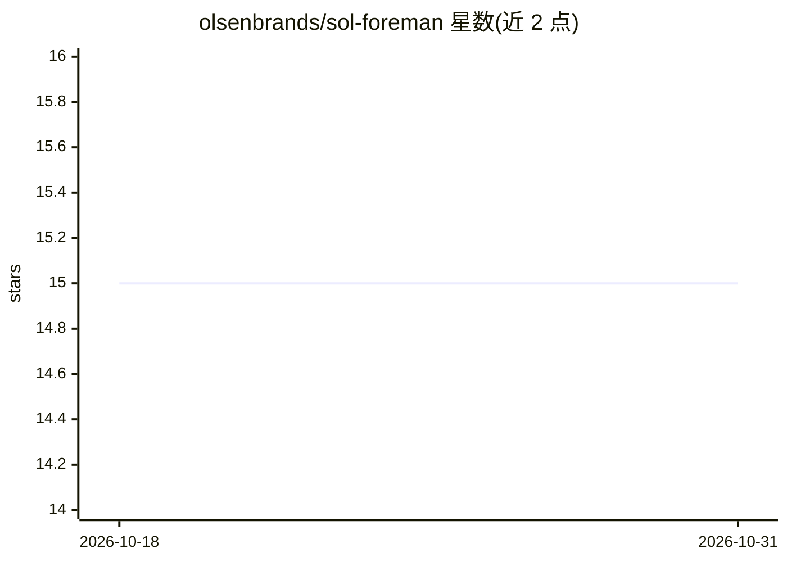

# olsenbrands/sol-foreman

⭐ 15 · Python · MIT · 推送 2026-10-22 · [GitHub](https://github.com/olsenbrands/sol-foreman) · [官网](https://dontsleeponai.com/) · 个人维护

**Codex 技能：以验收证据为导向的 AI 工作委派与路由**

面向 Codex 的独立 skill，用于领导委派式开发：定义可观测验收标准、按 Sol/Luna 及 Claude/Grok 别名做限定路由、委派单一行为给合格 worker、独立评审与最终验收。机制上按‘每被接受用户产出的成本’做路由决策，内建依赖 Python 3.9+ 的脚本（模型解析、能力探测、评审核算）。限制：Astra/Fable 需双重显式批准；Codex 为基线，Claude/Grok 为可选路由，无任何可选提供商也可运行。

## 筛选速览

| 维度 | 判定 | 备注 |
|---|---|---|
| AI 角色 | `ai-ecosystem` | LLM/agent 周边工具 |
| 许可风险 | `permissive` | MIT |
| 部署形态 | `None` |  |
| 模型依赖 | — | README 未给出锁定关系 |
| 硬件要求 | — | 无带数字的原话,不猜 |
| 安装摩擦 | `low` | 无编译、无系统依赖或容器化 |
| 成熟度 | — | 结构信号不足 |

## 能力要点

- Sol/Luna 与 Claude opus/sonnet/haiku 别名的限定路由，按可接受产出成本选路
- 独立评审与证据检查点：评审者不做验收，绿色检查不等于发布声明
- premium 模型（Astra/Fable）需双重显式批准并留痕，批准随会话失效
- 附带 Python 3.9+ 无依赖脚本：模型解析、能力探测、评审核算

## 适用场景

- 作为 Codex 主控委派实现、检查与修复工作给 worker
- 为有验收标准的任务选择最经济的合格路由
- 较大工程中按证据检查点推进并汇报基于证据的进度

## 场景标签

`多智能体` `编码 Agent` · 领域:Agent 开发

## 证据(README 行号)

> L7: I built Sol Foreman as a standalone Codex skill for leading delegated builds
> L82: - Use the smallest qualified crew. Codex-only is supported; optional Claude and

## 星数曲线

2026-10-18 15 → 2026-10-31 15（+0）

---
*卡片 v1 · prompt 1.4 · 生成 2026-10-30 · 置信度 high · 依据 README sha `9a7926928aef` · [字段定义](../../DATASET.md)*
