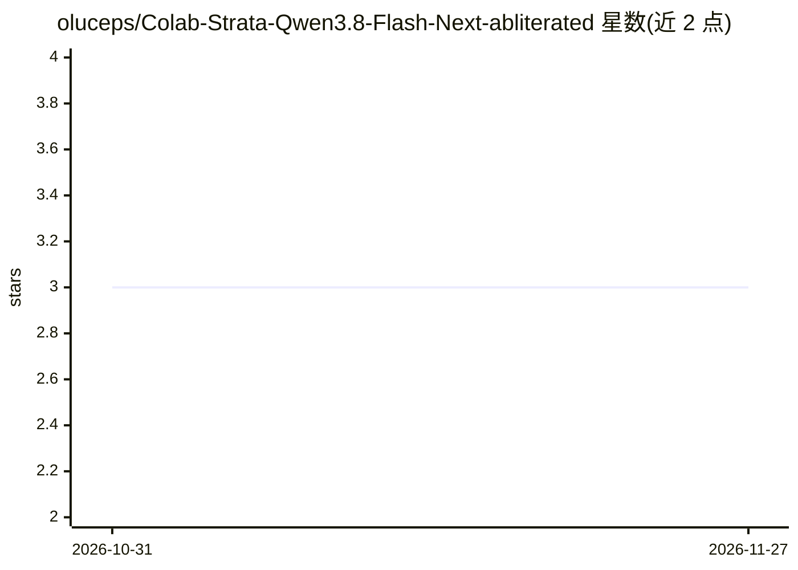

# oluceps/Colab-Strata-Qwen3.8-Flash-Next-abliterated

⭐ 3 · Python · Apache-2.0 · 推送 2026-11-10 · [GitHub](https://github.com/oluceps/Colab-Strata-Qwen3.8-Flash-Next-abliterated) · [官网](https://huggingface.co/alesha-pro/Qwen3.8-Flash-Next-abliterated-GSQ-RCO-Strata-GGUF) · 个人维护 · 中文 README

**在 Google Colab L4 上部署 Qwen3.8 量化模型并提供 OpenAI 兼容 API**

提供一组 Colab notebook 与 Python 源文件，在 Google Colab L4 High-RAM 运行时上运行 alesha-pro/Qwen3.8-Flash-Next-abliterated 的 GSQ-RCO IQ3_XXS GGUF 权重及拒绝方向控制向量，经 Strata 引擎暴露带鉴权的 OpenAI 兼容 Chat Completions、Anthropic Messages 与 OpenAI Responses 接口，消耗 Colab Pro 订阅计算额度。包含 MTP 投机解码、专家缓存、k8v4 KV 压缩等性能配置，提供 MCP+Agent Skill 与手动导入两种部署路径，并有保活日志循环与额度消耗估算。

## 筛选速览

| 维度 | 判定 | 备注 |
|---|---|---|
| AI 角色 | `ai-native` | 本体是模型或模型工具 |
| 许可风险 | `permissive` | Apache-2.0 |
| 部署形态 | `library` | 以包/库形式分发 |
| 模型依赖 | — | README 未给出锁定关系 |
| 硬件要求 | — | 无带数字的原话,不猜 |
| 安装摩擦 | `medium` | 含编译或系统依赖之一 |
| 成熟度 | — | 结构信号不足 |

## 能力要点

- 提供 OpenAI Chat Completions / Anthropic Messages / OpenAI Responses 三种兼容接口
- 默认 262,144 tokens 上下文，支持 IQ2_XS/IQ3_S/IQ3_XXS 三档量化切换
- 支持 MTP 投机解码、专家缓存 profile 持久化与 k8v4 KV 压缩
- 提供 Colab MCP + Agent Skill 的 agent 自动化部署流程

## 适用场景

- 在 Colab 额度内自建带鉴权的长上下文推理 API
- 为本地代码 agent 与 MCP 客户端提供远程模型后端
- 长上下文检索与 token 召回实验

## 场景标签

`推理引擎` · 领域:训练与推理

## 证据(README 行号)

> L7: 本项目在 Google Colab L4 High-RAM 环境运行 Qwen3.8-Flash-Next 的 GSQ-RCO IQ3_XXS 权重与拒绝方向控制向量，提供带鉴权的 OpenAI 兼容 Chat Completion
> L119: Strata 提供兼容 OpenAI Chat Completions（`POST /v1/chat/completions`）、Anthropic Messages 与 OpenAI Responses 的接口。详细说明参见 

## 星数曲线

2026-10-31 3 → 2026-11-27 3（+0）

---
*卡片 v1 · prompt 1.4 · 生成 2026-11-21 · 置信度 mid · 依据 README sha `54587c5a4ea7` · [字段定义](../../DATASET.md)*
