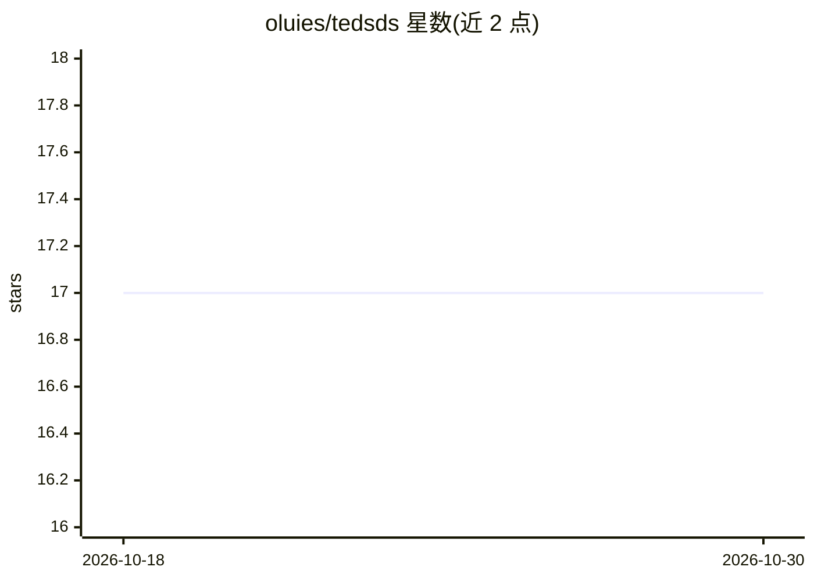

# oluies/tedsds

⭐ 17 · Jupyter Notebook · Apache-2.0 · 推送 2026-10-18 · [GitHub](https://github.com/oluies/tedsds) · 个人维护

**Apache Spark 上的涡轮发动机退化数据集预测性维护示例**

基于 NASA 的 Turbofan Engine Degradation Simulation Data Set（PHM08 论文来源）构建的 Apache Spark 机器学习示例工程，演示预测性维护场景。README 列出该数据集的多篇参考文献及同数据集的 Microsoft Cortana、H2O、Advanced Analytics with Spark 等其他示例，并给出所用 Spark 库（spark-csv）与 SBT 插件（sbt-spark-package、sbt-git）链接。仓库内容以 Scala/SBT 工程形式组织，面向学习 Spark 机器学习流程的开发者；README 未提供安装与运行命令的详细说明。

## 筛选速览

| 维度 | 判定 | 备注 |
|---|---|---|
| AI 角色 | `ai-native` | 本体是模型或模型工具 |
| 许可风险 | `permissive` | Apache-2.0 |
| 部署形态 | `None` |  |
| 模型依赖 | — | README 未给出锁定关系 |
| 硬件要求 | — | 无带数字的原话,不猜 |
| 安装摩擦 | `low` | 无编译、无系统依赖或容器化 |
| 成熟度 | — | 结构信号不足 |

## 能力要点

- 使用 NASA 涡轮发动机退化仿真数据集（PHM08）
- 演示预测性维护场景的 Spark 机器学习流程
- 依赖 spark-csv 库与 sbt-spark-package、sbt-git 插件

## 适用场景

- 学习在 Spark 上做预测性维护建模
- 作为退化数据集的参考实现进行修改实验

## 场景标签

`教程课程` · 领域:学习与行业

## 证据(README 行号)

> L2: ## Turbofan Engine Degradation Simulation Data Set example in Apache Spark
> L4: Uses the dataset from [1] to create a demostration of a machine learning setup for a predictive maintainance scenari

## 星数曲线

2026-10-18 17 → 2026-10-30 17（+0）

---
*卡片 v1 · prompt 1.4 · 生成 2026-10-29 · 置信度 mid · 依据 README sha `0f466a519099` · [字段定义](../../DATASET.md)*
