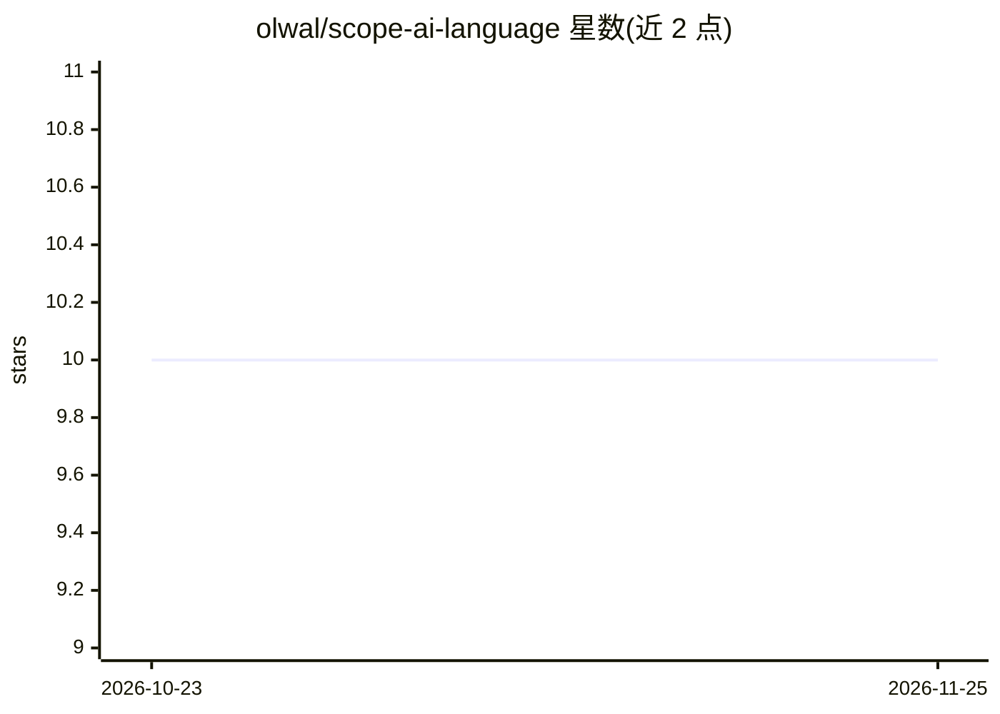

# olwal/scope-ai-language

⭐ 10 · Python · 推送 2026-06-30 · [GitHub](https://github.com/olwal/scope-ai-language) · 个人维护

**为 Daydream Scope 提供实时视频推理/生成的 AI 插件集**

面向 Daydream Scope 插件管线的一组实时 AI 插件：VLM/LLM 插件读取视频流生成语义描述，经 UDP 组播分发并可重写为扩散提示词，驱动实时图像生成，支持时间插值平滑过渡与外部 OSC/UDP 控制。基于 scope-bus/scope-language 共享库，经 Scope UI 安装，另提供 RunPod 分体部署方案（Ollama 独立 pod）。

## 筛选速览

| 维度 | 判定 | 备注 |
|---|---|---|
| AI 角色 | `ai-native` | 本体是模型或模型工具 |
| 许可风险 | `none` | — |
| 部署形态 | `None` |  |
| 模型依赖 | local-ok | 支持本地模型 |
| 硬件要求 | — | 无带数字的原话,不猜 |
| 安装摩擦 | `low` | 无编译、无系统依赖或容器化 |
| 成熟度 | — | 结构信号不足 |

## 能力要点

- VLM 实时描述视频内容并注入扩散提示词
- UDP 组播 239.255.42.99 fan-out，端口即通道
- 时间插值（slerp/线性）平滑切换语义状态
- 支持 OSC/UDP 外部工具驱动与并行链式插件

## 适用场景

- 实时视频流驱动的 AI 图像生成演出
- 现场绘画的视觉自动补全/动画生成
- TouchDesigner、Ableton、Max/MSP 等工具接入生成管线
- RunPod 云端分体部署运行 Scope 与 Ollama

## 场景标签

`图像生成` `多模态` · 领域:内容生成

## 证据(README 行号)

> L7: Real-time AI plugins that close the loop between **seeing** and **generating**. The system watches a video stream, r
> L43: Built on Ollama for local or remote VLM/LLM inference. Shared libraries handle all transport, frame conversion, tex

## 星数曲线

2026-10-23 10 → 2026-11-25 10（+0）

---
*卡片 v1 · prompt 1.4 · 生成 2026-11-19 · 置信度 high · 依据 README sha `3d898f68ddff` · [字段定义](../../DATASET.md)*
