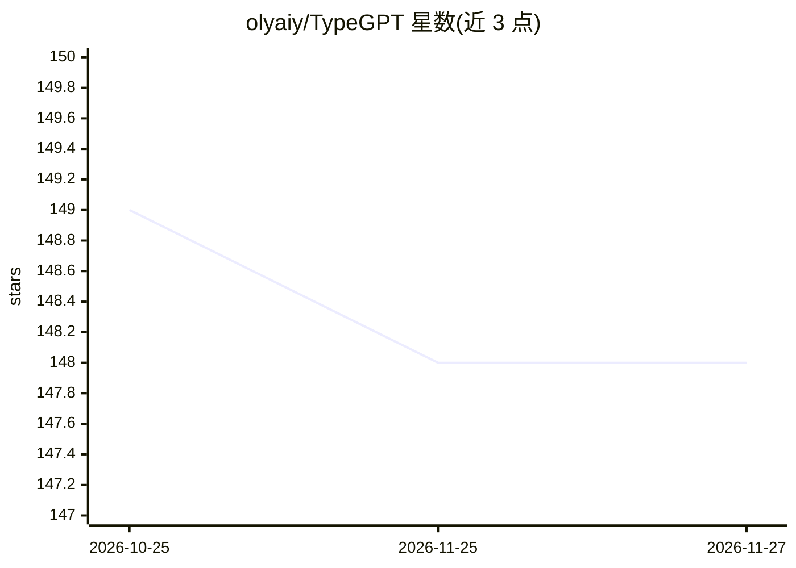

# olyaiy/TypeGPT

⭐ 148 · Python · Apache-2.0 · 推送 2026-11-23 · [GitHub](https://github.com/olyaiy/TypeGPT) · [官网](https://discord.gg/Vfxeb2U2Ay) · 个人维护

**系统级文本框快捷调用 LLM 的桌面工具**

Python 编写的桌面应用，监听键盘快捷键，在操作系统任意文本输入框内调用 AI/LLM：以斜杠命令选择模型，输入问题后答案以打字方式写回当前文本框。支持 Claude、GPT、DeepSeek、Gemini 及 OpenRouter 全部模型和 Ollama 本地模型，模型经 models.toml 配置。附带 GUI 管理器管理 API key 与启停状态；扩展功能包括截图提问（/see）、网页搜索（/search，走 DeepSeek）与只读本地文件夹问答（/files，含 PDF 视觉 OCR 索引）。安装需 git clone 后运行 install.sh（uv 管理 Python 3.12 与依赖），需各提供商 API key。

## 筛选速览

| 维度 | 判定 | 备注 |
|---|---|---|
| AI 角色 | `ai-native` | 本体是模型或模型工具 |
| 许可风险 | `permissive` | Apache-2.0 |
| 部署形态 | `None` |  |
| 模型依赖 | local-ok | 支持本地模型 |
| 硬件要求 | — | 无带数字的原话,不猜 |
| 安装摩擦 | `low` | 无编译、无系统依赖或容器化 |
| 成熟度 | — | 结构信号不足 |

## 能力要点

- 在任意文本输入框中通过快捷键与斜杠命令调用多个 LLM
- models.toml 配置模型，OpenRouter 单 key 覆盖全部模型
- 截图提问、网页搜索与只读本地文件问答（含 PDF OCR 索引）
- GUI 管理器管理 API key 与程序状态，支持 Ollama 本地模型

## 适用场景

- 在聊天应用、文档或编辑器里随时用快捷键向 AI 提问
- 对截图内容直接提问
- 让模型基于本地课程笔记等文件夹检索作答
- 用 Ollama 本地模型在任意输入框生成回复

## 场景标签

`AI 助手` `文档问答` · 领域:对话与助手

## 证据(README 行号)

> L5: TypeGPT is a Python application that allows you to invoke various AI's and LLM's from any text field in your operati
> L15: - **Keyboard Shortcuts**: Use simple keyboard shortcuts to communicate with AI models.

## 星数曲线

2026-10-25 149 → 2026-11-27 148（-1）

---
*卡片 v1 · prompt 1.4 · 生成 2026-11-27 · 置信度 high · 依据 README sha `c17f5aa9e3ff` · [字段定义](../../DATASET.md)*
