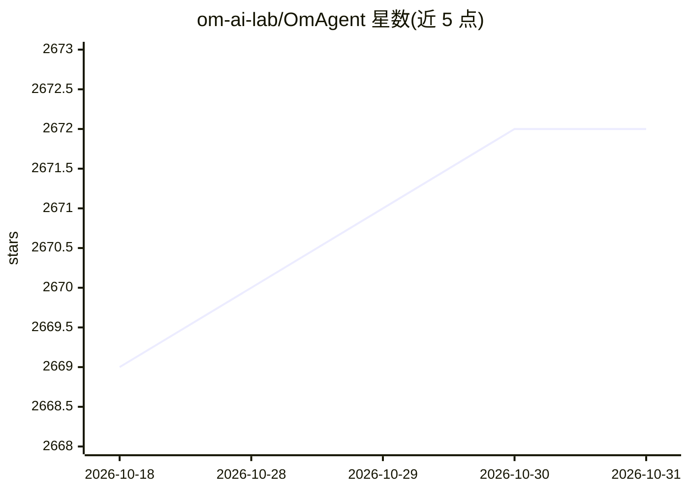

# om-ai-lab/OmAgent

⭐ 2,672 · Python · Apache-2.0 · 推送 2026-10-16 · [GitHub](https://github.com/om-ai-lab/OmAgent) · [官网](https://om-agent.com) · 组织维护

**构建多模态语言 Agent 的 Python 框架**

面向开发者和研究者的多模态语言 Agent 构建库：在后台封装 worker 编排、任务队列、节点优化等工程细节，提供易用接口与可复用组件抽象；支持图式工作流编排、多种记忆类型、VLM 模型、视频处理与移动设备连接，内置 ReAct、CoT、SC-CoT 等 Agent 算法。支持通过 Ollama 或 LocalAI 本地部署模型，亦支持 OpenAI 兼容端点。架构为全分布式并支持 Lite 模式（无需部署中间件）。提供视频问答、移动个人助理等示例工程，配套论文发表于 EMNLP-2024。要求 Python >= 3.10，通过 pip 安装。

## 筛选速览

| 维度 | 判定 | 备注 |
|---|---|---|
| AI 角色 | `ai-ecosystem` | LLM/agent 周边工具 |
| 许可风险 | `permissive` | Apache-2.0 |
| 部署形态 | `library` | 以包/库形式分发 |
| 模型依赖 | local-ok | 支持本地模型 |
| 硬件要求 | — | 无带数字的原话,不猜 |
| 安装摩擦 | `low` | 无编译、无系统依赖或容器化 |
| 成熟度 | — | 结构信号不足 |

## 能力要点

- 图式工作流编排引擎与多种记忆类型支持上下文推理
- 原生多模态支持：VLM 模型、实时 API、计算机视觉模型、移动设备连接
- 内置 ReAct、CoT、SC-CoT 等 Agent 算法套件
- 支持 Ollama / LocalAI 本地部署模型，分布式架构并提供 Lite 模式

## 适用场景

- 我想快速搭建能理解图像、视频、音频的多模态 Agent
- 我想用本地部署的模型（Ollama/LocalAI）运行 Agent 而不依赖云端 API
- 我想复用 ReAct、CoT 等现成推理算法组件构建复杂 Agent

## 场景标签

`Agent 框架` `多模态` · 领域:Agent 开发

## 证据(README 行号)

> L11: OmAgent is python library for building multimodal language agents with ease. We try to keep the library **simple** 
> L12:  - We wrap the complex engineering (worker orchestration, task queue, node optimization, etc.) behind the scene and

## 星数曲线

2026-10-18 2,669 → 2026-10-31 2,672（+3）

---
*卡片 v1 · prompt 1.4 · 生成 2026-10-21 · 置信度 high · 依据 README sha `4cc3c3ffac2f` · [字段定义](../../DATASET.md)*
