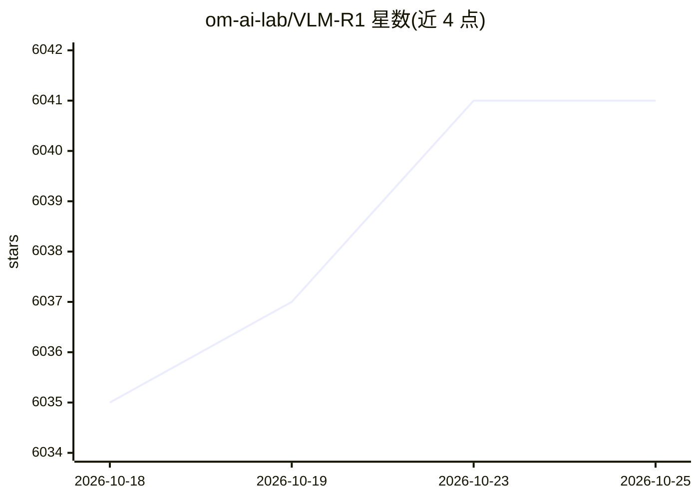

# om-ai-lab/VLM-R1

⭐ 6,042 · Python · Apache-2.0 · 推送 2026-07-07 · [GitHub](https://github.com/om-ai-lab/VLM-R1) · 组织维护

**R1 式强化学习训练的视觉语言模型及 GRPO 训练代码库**

基于 Qwen2.5-VL 用 GRPO 强化学习训练的 R1 式大型视觉语言模型项目，发布 REC、OVD、Math、GUI 缺陷检测四类模型权重与 Hugging Face 演示，并开源训练代码库：支持 GRPO 全量微调与 LoRA、冻结视觉模块、多机训练、多图输入、自定义数据与奖励函数，兼容 QwenVL 和 InternVL。SFT 基线通过 LLaMA-Factory 训练。安装需 conda 环境 setup.sh，训练与评测用 torchrun 多卡运行；模型已适配华为昇腾 Atlas 系列（vllm-ascend / xllm）推理。

## 筛选速览

| 维度 | 判定 | 备注 |
|---|---|---|
| AI 角色 | `ai-native` | 本体是模型或模型工具 |
| 许可风险 | `permissive` | Apache-2.0 |
| 部署形态 | `library` | 以包/库形式分发 |
| 模型依赖 | local-ok | 支持本地模型 |
| 硬件要求 | — | 无带数字的原话,不猜 |
| 安装摩擦 | `medium` | 含编译或系统依赖之一 |
| 成熟度 | — | 结构信号不足 |

## 能力要点

- 基于 Qwen2.5-VL 的 GRPO 强化学习训练，含 REC/OVD/Math/GUI 四类模型权重
- 训练代码支持全量/LoRA 微调、冻结视觉模块、多节点训练与多图输入
- 支持自定义 jsonl 数据与自定义奖励函数，兼容 QwenVL 与 InternVL
- 模型适配华为昇腾 Atlas 800T A2 / 300I Duo 推理（vllm-ascend / xllm）

## 适用场景

- 用强化学习训练视觉定位（REC）与开放词表检测（OVD）模型
- 复现 R1 式多模态推理训练并与 SFT 基线对比
- 在自有数据上用自定义奖励函数做 GRPO 训练
- 在昇腾硬件上部署 VLM-R1 系列模型推理

## 场景标签

`多模态` `微调` `强化学习` · 领域:感知与多模态

## 证据(README 行号)

> L13: Since the introduction of Deepseek-R1, numerous works have emerged focusing on reproducing and improving upon it. I
> L24: - **`Full Fine-tuning for GRPO`**: see run_grpo_rec.sh
> L61: - **`REC`**: Trained with VLM-R1, our Referring Expression Comprehension (REC) model showcases the superior perform

## 星数曲线

2026-10-18 6,035 → 2026-10-25 6,041（+6）

---
*卡片 v1 · prompt 1.4 · 生成 2026-10-20 · 置信度 mid · 依据 README sha `67927719d16e` · [字段定义](../../DATASET.md)*
