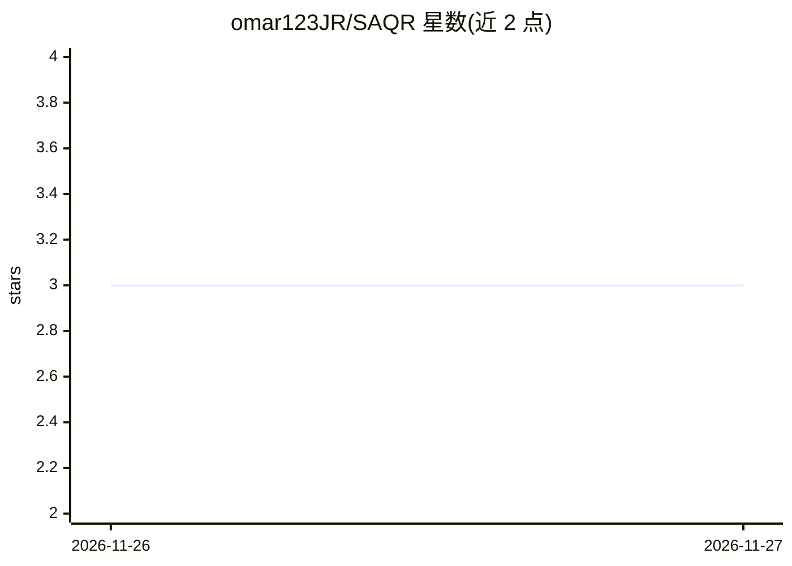

# omar123JR/SAQR

⭐ 3 · NOASSERTION · 推送 2026-11-25 · [GitHub](https://github.com/omar123JR/SAQR) · 个人维护 · 中文 README

**面向中小机构的 Mini-SOC 威胁检测与自动化响应平台**

SAQR 是一个安全事件检测与自动响应平台，采用五层架构：隔离的 Windows 10 受害虚拟机（Sysmon 采集）、Wazuh 检测引擎（Sigma 与自定义勒索行为规则）、FastAPI 决策核心（事件关联与 T0–T4 时间戳）、取证与响应层（进程内存转储、SHA-256 签名、防火墙隔离主机），以及报告与仪表盘层。响应按确定性规则执行，Gemini API 仅在隔离完成后生成阿拉伯语事件报告，无隔离决策与命令执行权限。为私有学术项目，未提供安装命令。

## 筛选速览

| 维度 | 判定 | 备注 |
|---|---|---|
| AI 角色 | `ai-enhanced` | 去掉 AI 部分产品仍成立 |
| 许可风险 | `none` | NOASSERTION |
| 部署形态 | `self-host` | docker 或自建部署 |
| 模型依赖 | — | README 未给出锁定关系 |
| 硬件要求 | — | 无带数字的原话,不猜 |
| 安装摩擦 | `low` | 无编译、无系统依赖或容器化 |
| 成熟度 | — | 结构信号不足 |

## 能力要点

- 勒索软件检测、关联、隔离、取证的确定性自动响应流水线
- 隔离前对进程内存转储做 SHA-256 签名保存证据
- Gemini API 仅用于事后阿拉伯语报告生成，不参与决策
- 计划 20 项标准实验并记录 MTTD/MTTC 等指标

## 适用场景

- 为缺乏专职 SOC 团队的机构提供安全事件检测与自动隔离
- 模拟勒索软件、定向钓鱼、DDoS 攻击做防御演练
- 在阿拉伯语环境生成安全事件报告并做 MITRE ATT&CK 映射

## 场景标签

`网络安全` `工作流自动化` · 领域:效率与自动化

## 证据(README 行号)

> L10:  منصة ذكية متكاملة للاستجابة الآلية للحوادث الأمنية بمركز عمليات مصغّر (Mini-SOC) ونواة استجابة حتمية (SOAR) مع طبق
> L44: * 🤖 **تقارير Gemini API:** استخدام Gemini API لصياغة تحليل وتقرير عربي بعد انتهاء الاحتواء؛ لا يملك النموذج صلاحية 
> L83: > **"الاستجابة تُنفذ بقواعد حتمية + الذكاء الاصطناعي للتحليل بعد الاحتواء."**

## 星数曲线

2026-11-26 3 → 2026-11-27 3（+0）

---
*卡片 v1 · prompt 1.4 · 生成 2026-11-26 · 置信度 mid · 依据 README sha `cb75b7f4b085` · [字段定义](../../DATASET.md)*
