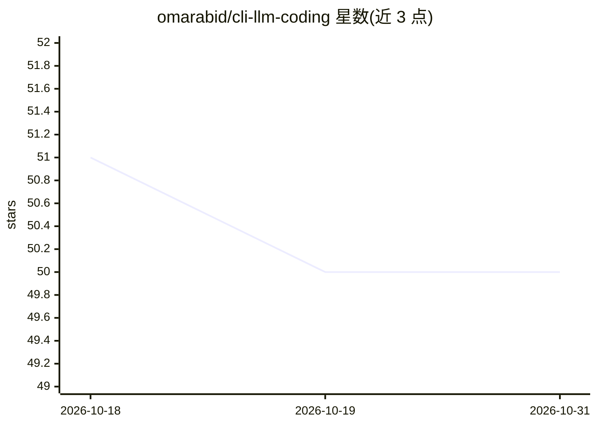

# omarabid/cli-llm-coding

⭐ 50 · 推送 2026-07-13 · [GitHub](https://github.com/omarabid/cli-llm-coding) · [官网](https://codeinput.com) · 个人维护

**CLI 编码 agent 工具策展清单：收录类 Claude Code 的终端工具**

维护一份 CLI agentic 编码工具的对比清单：收录 Claude Code、Gemini CLI、Goose、Aider、Codex-CLI 等 14 个终端优先/纯终端的编码 agent 工具，按表格列出项目链接、模型后端（如 Anthropic、OpenAI、Ollama、Open-AI-compat）、许可证与实现语言。部分条目标注 archived 状态。面向寻找 Claude Code 替代方案的开发者，纯清单形式，无可安装本体。

## 筛选速览

| 维度 | 判定 | 备注 |
|---|---|---|
| AI 角色 | `ai-knowledge` | 知识聚合/清单类 |
| 许可风险 | `none` | — |
| 部署形态 | `None` |  |
| 模型依赖 | — | README 未给出锁定关系 |
| 硬件要求 | — | 无带数字的原话,不猜 |
| 安装摩擦 | `low` | 无编译、无系统依赖或容器化 |
| 成熟度 | — | 结构信号不足 |

## 能力要点

- 收录 14 个终端优先/纯终端的 CLI 编码 agent 工具
- 表格对比模型后端、许可证与实现语言
- 筛选标准限定为类 Claude Code 的 CLI 工具
- 标注已归档条目（如 opencode-ai/opencode）

## 适用场景

- 寻找 Claude Code 的 CLI 替代工具
- 对比各编码 agent 支持的模型后端与许可证
- 了解 CLI 编码 agent 生态的工具分布

## 场景标签

`精选清单` · 领域:学习与行业

## 证据(README 行号)

> L3: A list of CLI agentic coding tools. This list is curated to include Terminal-only (or first) CLI tools similar to Cl
> L5: |Tool|Project Link|Model back-ends|Licence|Language|

## 星数曲线

2026-10-18 51 → 2026-10-31 50（-1）

---
*卡片 v1 · prompt 1.4 · 生成 2026-10-24 · 置信度 high · 依据 README sha `ed312e70d4e2` · [字段定义](../../DATASET.md)*
