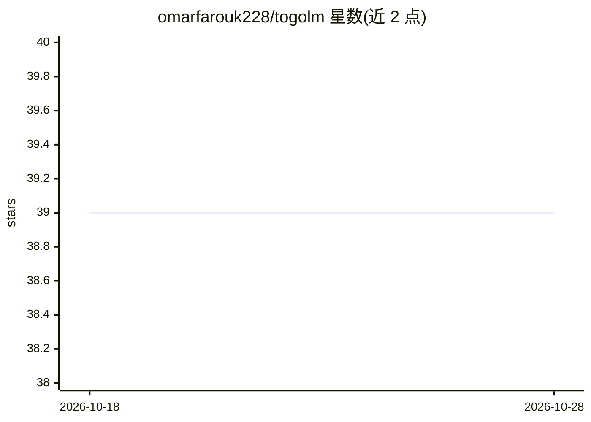

# omarfarouk228/togolm

⭐ 40 · Python · 推送 2026-10-25 · [GitHub](https://github.com/omarfarouk228/togolm) · [官网](https://togolm.com) · 个人维护

**面向多哥的开源 AI 知识层：6.2万文档语料+RAG API+微调模型**

从网页抓取到公开 REST API 的完整流水线：35 个爬虫从 55+ 来源采集 62,000+ 篇多哥结构化文档（法律、政府数据、媒体、教育），存入带 pgvector 的 PostgreSQL，提供 RAG 查询、全文检索、嵌入生成等公开端点与 JWT 保护的语料/密钥管理 Admin API，并附 JS/TS 与 Python SDK。嵌入默认用本地多语 MiniLM 模型，检测到 GEMINI_API_KEY 时切换 Gemini。微调管线基于 QLoRA 适配 Mistral 7B Instruct v0.3（训练进行中），模型与语料发布于 HuggingFace。面向多哥及西非法语区的开发者、初创与机构。

## 筛选速览

| 维度 | 判定 | 备注 |
|---|---|---|
| AI 角色 | `ai-ecosystem` | LLM/agent 周边工具 |
| 许可风险 | `permissive` | — |
| 部署形态 | `library` | 以包/库形式分发 |
| 模型依赖 | — | README 未给出锁定关系 |
| 硬件要求 | — | 无带数字的原话,不猜 |
| 安装摩擦 | `low` | 无编译、无系统依赖或容器化 |
| 成熟度 | `idea` | |

## 能力要点

- 62,000+ 多哥文档语料（35 爬虫、55+ 来源，含政府/法律/媒体/教育）
- 公开 REST API：RAG 查询、法语全文检索、384 维嵌入生成
- Admin API：语料统计、API key CRUD、查询分析
- QLoRA 微调 Mistral 7B Instruct v0.3，模型与语料托管 HuggingFace

## 适用场景

- 在多哥/西非法语区语料上构建问答与检索应用
- 通过公开 API 或 SDK 接入多哥本地化知识查询
- 获取多哥政府、法律、经济领域结构化语料用于本地化 LLM 训练

## 场景标签

`RAG` `网页抓取` `微调` · 领域:效率与自动化

## 证据(README 行号)

> L10: TogoLM is an open-source AI knowledge layer for Togo — a complete pipeline from raw web scraping to a fine-tuned LL
> L18: |**Public API**|REST endpoints consumable by any developer or app|

## 星数曲线

2026-10-18 39 → 2026-10-28 39（+0）

---
*卡片 v1 · prompt 1.4 · 生成 2026-10-25 · 置信度 high · 依据 README sha `fd88af7f169d` · [字段定义](../../DATASET.md)*
