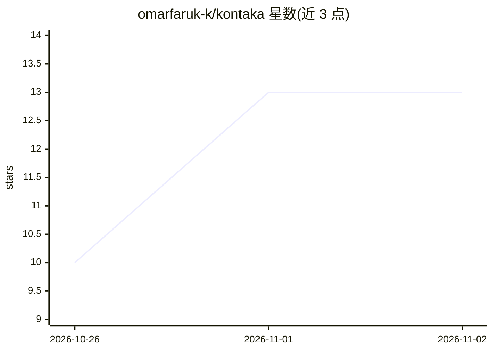

# omarfaruk-k/kontaka

⭐ 13 · C++ · NOASSERTION · 推送 2026-03-11 · [GitHub](https://github.com/omarfaruk-k/kontaka) · 个人维护

**视障用户用的孟加拉纸币识别 App，语音播报面额**

面向视障人士的 Android 辅助应用：用手机摄像头实时采集纸币图像，经预处理后由 TensorFlow Lite 部署的 MobileNetV2 迁移学习模型（15 类、9 种孟加拉纸币面额）离线推理识别，识别结果以孟加拉语语音播报。无需登录与联网。模型基于自采的 17,836 张图像训练，验证集准确率 99.89%，单帧处理约 627ms。通过 GitHub Releases 提供 APK 下载。

## 筛选速览

| 维度 | 判定 | 备注 |
|---|---|---|
| AI 角色 | `ai-native` | 本体是模型或模型工具 |
| 许可风险 | `none` | NOASSERTION |
| 部署形态 | `None` |  |
| 模型依赖 | — | README 未给出锁定关系 |
| 硬件要求 | — | 无带数字的原话,不猜 |
| 安装摩擦 | `low` | 无编译、无系统依赖或容器化 |
| 成熟度 | — | 结构信号不足 |

## 能力要点

- 设备端离线推理（TensorFlow Lite + MobileNetV2）
- 孟加拉语语音播报识别出的纸币面额
- 自采 17,836 张图像、15 类、9 种面额的训练数据
- 无需登录与网络连接

## 适用场景

- 视障用户用手机摄像头独立识别孟加拉纸币面额
- 通过语音播报获知手持纸币金额

## 场景标签

`目标检测` · 领域:感知与多模态

## 证据(README 行号)

> L3: Kontaka is a mobile-based assistive application that recognizes Bangladeshi banknotes using deep learning and announ
> L18: Camera Input → Image Preprocessing → Deep Learning Model (TFLite) → Prediction → Bangla Voice Output

## 星数曲线

2026-10-26 10 → 2026-11-02 13（+3）

---
*卡片 v1 · prompt 1.4 · 生成 2026-10-31 · 置信度 high · 依据 README sha `6b040cf47ba1` · [字段定义](../../DATASET.md)*
