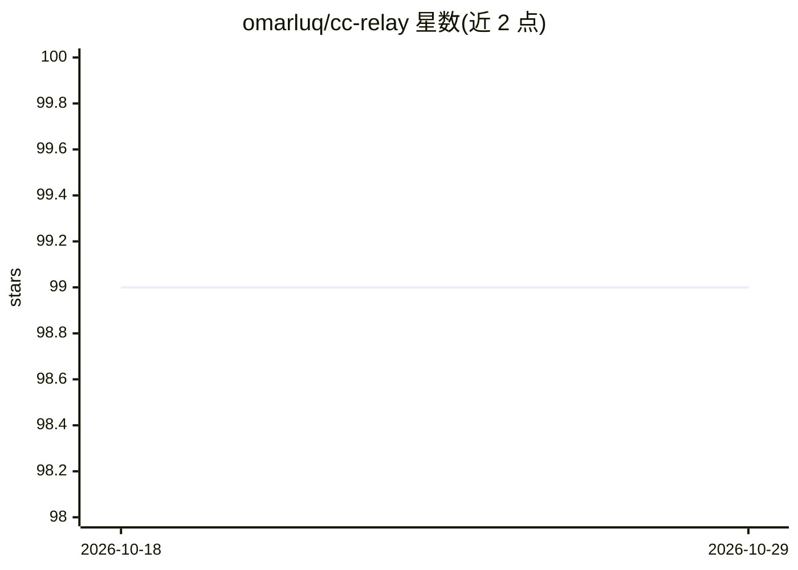

# omarluq/cc-relay

⭐ 99 · Go · AGPL-3.0 · 推送 2026-10-27 · [GitHub](https://github.com/omarluq/cc-relay) · [官网](https://cc-relay.ai) · 个人维护

**Go 编写的 LLM API 网关：多密钥池化与跨供应商故障转移**

面向 Claude Code 等 Anthropic API 客户端的 LLM 网关，用 Go 编写：将多个 Anthropic API key 池化以聚合速率限制，把简单任务路由到更轻量的模型，在多个供应商（Bedrock/Azure/Vertex 及 MiniMax、Z.AI、Ollama 等 Anthropic 兼容供应商）之间自动故障转移，支持企业凭证与个人 key 并用。以 AGPL-3.0 许可的开源仓库形式提供，附 Website、Documentation 与 Go Reference 徽章。README 主体较短，安装运行细节位于文档站。

## 筛选速览

| 维度 | 判定 | 备注 |
|---|---|---|
| AI 角色 | `ai-ecosystem` | LLM/agent 周边工具 |
| 许可风险 | `viral` | AGPL-3.0 |
| 部署形态 | `None` |  |
| 模型依赖 | locked-api |  |
| 硬件要求 | — | 无带数字的原话,不猜 |
| 安装摩擦 | `low` | 无编译、无系统依赖或容器化 |
| 成熟度 | — | 结构信号不足 |

## 能力要点

- 跨多个 Anthropic API key 池化速率限制
- 供应商间自动故障转移（Bedrock/Azure/Vertex 及兼容供应商）
- 按任务轻重路由到不同模型
- 支持接入 MiniMax、Z.AI、Ollama 等 Anthropic 兼容供应商

## 适用场景

- Claude Code 用户聚合多个 API key 突破速率限制
- 把简单任务路由到更轻量模型以控制成本
- 供应商不可用时自动切换，避免任务中断

## 场景标签

`模型网关` · 领域:Agent 开发

## 证据(README 行号)

> L20:  Claude Code connects to one provider at a time. But what if you want to:
> L24:  🛡️ Never get stuck with automatic failover between providers

## 星数曲线

2026-10-18 99 → 2026-10-29 99（+0）

---
*卡片 v1 · prompt 1.4 · 生成 2026-10-23 · 置信度 high · 依据 README sha `8a49ac64596c` · [字段定义](../../DATASET.md)*
