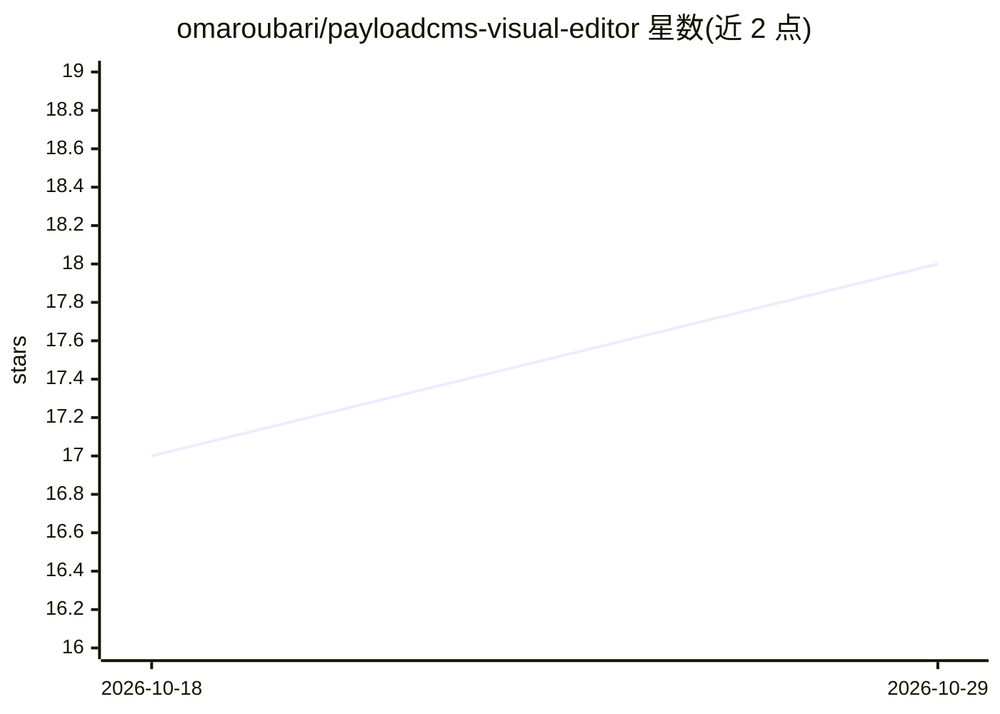

# omaroubari/payloadcms-visual-editor

⭐ 18 · TypeScript · 推送 2026-05-06 · [GitHub](https://github.com/omaroubari/payloadcms-visual-editor) · 个人维护

**Payload CMS 可视化编辑插件：页内直接改内容并批注反馈**

面向使用 Payload CMS 3.x 的开发团队与内容编辑的插件：内容编辑在前端页面上点击即改文本字段、存草稿或发布，无需回到管理面板；对代码层面的元素（布局、样式、组件）切换到批注模式，放置编号标记并可导出 markdown、发送 webhook（GitHub issues、CI）或经 MCP 连接 AI agent（标注 coming soon）。机制上通过 `_sourceMap` 字段与 `createEditableAttrs` 标记可编辑元素。限制：需启用 Payload draft 模式，仅支持文本字段。

## 筛选速览

| 维度 | 判定 | 备注 |
|---|---|---|
| AI 角色 | `ai-enhanced` | 去掉 AI 部分产品仍成立 |
| 许可风险 | `permissive` | — |
| 部署形态 | `library` | 以包/库形式分发 |
| 模型依赖 | — | README 未给出锁定关系 |
| 硬件要求 | — | 无带数字的原话,不猜 |
| 安装摩擦 | `low` | 无编译、无系统依赖或容器化 |
| 成熟度 | `idea` | |

## 能力要点

- 页内点击编辑 CMS 文本字段，支持草稿保存与发布
- 编号标记批注模式，可导出 markdown 或发送 webhook
- MCP 连接 AI agent（coming soon）
- 插件为每个 collection 注入虚拟 `_sourceMap` 字段实现内容到路径映射

## 适用场景

- 内容编辑直接在页面上改文案，省去前后台切换
- 对页面上的代码元素放批注并转 GitHub issue 给开发者
- 把批注反馈经 webhook 接入 CI 或 AI agent 流程

## 场景标签

 · 领域:Web 开发/CMS 工具

## 证据(README 行号)

> L7: **Payload Visual Editor** eliminates the round-trip between your frontend and the admin panel. Content editors click
> L13: - **Route Feedback Anywhere** — Export annotations as markdown, send them to a webhook (GitHub issues, CI pipelines

## 星数曲线

2026-10-18 17 → 2026-10-29 18（+1）

---
*卡片 v1 · prompt 1.4 · 生成 2026-10-29 · 置信度 high · 依据 README sha `f6b9e49a7438` · [字段定义](../../DATASET.md)*
