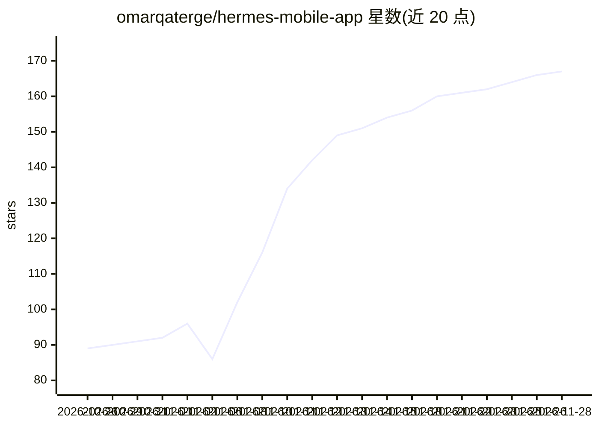

# omarqaterge/hermes-mobile-app

⭐ 167 · TypeScript · MIT · 推送 2026-11-27 · [GitHub](https://github.com/omarqaterge/hermes-mobile-app) · 个人维护

**把 Hermes Agent 装进 Android 手机的原生 App，全程本机运行**

Hermux 是非官方社区项目，将开源 Hermes Agent 包装为 Android 原生应用，Agent 本体运行在手机 Termux 的 Linux 环境中，无需 root。它以隐藏屏方式操作其他 App、以通知交互审批与提问、在聊天旁以画布共建页面与 3D 内容、提供离线听写与 Live 语音模式、维护可读可编辑的记忆与技能。模型接入依赖外部订阅或 API key，暂无离线本地模型；目前无独立安全审计，维护者一人。

## 筛选速览

| 维度 | 判定 | 备注 |
|---|---|---|
| AI 角色 | `ai-native` | 本体是模型或模型工具 |
| 许可风险 | `permissive` | MIT |
| 部署形态 | `None` |  |
| 模型依赖 | — | README 未给出锁定关系 |
| 硬件要求 | — | 无带数字的原话,不猜 |
| 安装摩擦 | `medium` | 含编译或系统依赖之一 |
| 成熟度 | — | 结构信号不足 |

## 能力要点

- 隐藏屏操作手机 App：读取元素列表而非截图，避开截图屏蔽场景（Android 14+）
- App 关闭时通过通知完成审批、提问与回复
- 聊天旁画布共建页面/图表/3D 场景，每次变更可版本对比与回滚
- 记忆与技能可查看、编辑、删除，背景自我复盘沉淀技能

## 适用场景

- 把日常待办交给手机上的 agent 定时执行（如每天早 8 点汇总天气与新闻）
- 跨购物 App 比价并整理成表格
- 把下载目录的 CSV 做成交互式消费看板
- 查询手机存储、电池、文件等本机状态

## 场景标签

`AI 助手` `GUI 自动化` `Agent 记忆` · 领域:Agent 开发

## 证据(README 行号)

> L3:  The Hermes agent, running natively on your Android phone.
> L19: Hermux puts the open-source Hermes Agent in your pocket and gives it
> L23: Termux on the same phone, so the whole thing is yours and self-contained.

## 星数曲线

2026-10-26 89 → 2026-11-28 167（+78）

---
*卡片 v1 · prompt 1.4 · 生成 2026-11-27 · 置信度 high · 依据 README sha `36efa5a5c83e` · [字段定义](../../DATASET.md)*
