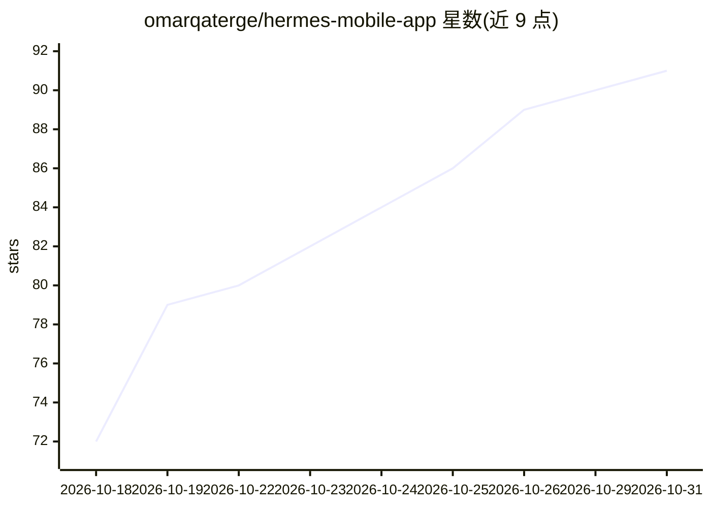

# omarqaterge/hermes-mobile-app

⭐ 91 · TypeScript · MIT · 推送 2026-10-30 · [GitHub](https://github.com/omarqaterge/hermes-mobile-app) · 个人维护

**在 Android 手机上本地运行 Hermes Agent 的原生聊天客户端**

非官方社区项目，为原本运行在终端的 Hermes Agent 提供手机界面：Hermes 在同机 Termux 的 Debian 环境中运行，应用通过 localhost 通信并提供流式聊天、工具卡片、状态栏审批、共享画布、语音与助手模式、定时任务、文件浏览器等。代理可经 Shizuku 在隐藏屏幕上读取和操作其他应用。安装需 Termux 三件套与 Shizuku，Android 8+（arm64）、约 6GB 空间，耗时 15-40 分钟；模型需订阅账号或 API key。React + TypeScript 编写，MIT 许可。

## 筛选速览

| 维度 | 判定 | 备注 |
|---|---|---|
| AI 角色 | `ai-native` | 本体是模型或模型工具 |
| 许可风险 | `permissive` | MIT |
| 部署形态 | `library` | 以包/库形式分发 |
| 模型依赖 | locked-api |  |
| 硬件要求 | — | 无带数字的原话,不猜 |
| 安装摩擦 | `medium` | 含编译或系统依赖之一 |
| 成熟度 | — | 结构信号不足 |

## 能力要点

- Hermes Agent 完全在手机端 Termux 中运行，无需服务器
- 状态栏（Android 16 Live Update）审批与通知，应用关闭后仍可用
- 共享画布：实时生成 HTML/3D 内容，版本可回滚，HTML 沙箱默认离线
- 经 Shizuku 在隐藏屏幕代用户操作其他应用（Android 14+）

## 适用场景

- 在手机上与 Hermes Agent 对话并审批其工具调用
- 让代理在手机本地操作其他应用完成任务的端到端体验
- 把手机默认数字助手设为 Hermes，长按电源键进入免提 Live 模式

## 场景标签

`聊天机器人` `AI 助手` `GUI 自动化` · 领域:效率与自动化

## 证据(README 行号)

> L19: Hermes Agent is a powerful agent, but it lives in a terminal. Hermes Mobile gives it a proper phone interface: stre
> L93: Hermes runs in Termux on the phone, and the app talks to it over localhost the same way Hermes Desktop does (it als

## 星数曲线

2026-10-18 72 → 2026-10-31 91（+19）

---
*卡片 v1 · prompt 1.4 · 生成 2026-10-24 · 置信度 mid · 依据 README sha `30535c41a7f2` · [字段定义](../../DATASET.md)*
