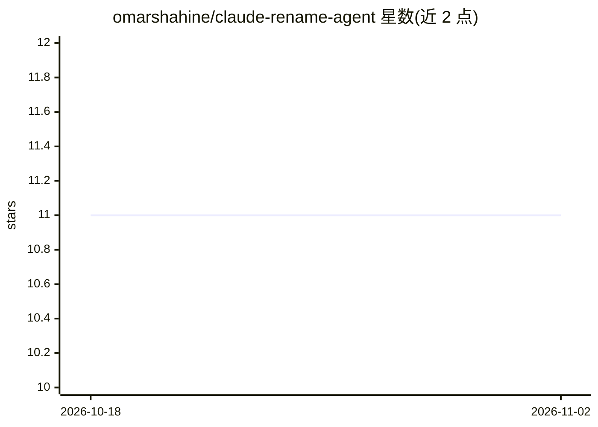

# omarshahine/claude-rename-agent

⭐ 11 · Python · MIT · 推送 2026-09-20 · [GitHub](https://github.com/omarshahine/claude-rename-agent) · 个人维护

**基于 Claude Agent SDK 的 AI 文件重命名代理**

用 Claude Agent SDK 构建的文件重命名工具：读取 PDF、图片与文本，由 Claude 分类文档类型（收据、账单、税单、银行对账单等 15 类）并抽取字段，按含 {Date}/{Merchant}/{Amount} 等令牌的模板批量生成文件名，学习并保存有效模式，保留历史记录。提供 CLI 与 Claude Code 技能集成（斜杠命令或自然语言触发），支持 dry-run 预览。需 Python 3.10+、Claude Code 与 ANTHROPIC_API_KEY。

## 筛选速览

| 维度 | 判定 | 备注 |
|---|---|---|
| AI 角色 | `ai-native` | 本体是模型或模型工具 |
| 许可风险 | `permissive` | MIT |
| 部署形态 | `library` | 以包/库形式分发 |
| 模型依赖 | locked-api |  |
| 硬件要求 | — | 无带数字的原话,不猜 |
| 安装摩擦 | `low` | 无编译、无系统依赖或容器化 |
| 成熟度 | — | 结构信号不足 |

## 能力要点

- Claude 分类 15 种文档类型并抽取字段
- 令牌模板命名与模式学习（patterns.json）
- 批量处理、dry-run 预览与历史跟踪
- Claude Code 技能集成（斜杠命令/自然语言触发）

## 适用场景

- 批量整理下载目录里的收据、税单和银行对账单
- 按固定命名规范统一重命名文档并让工具记住模式
- 在 Claude Code 中用自然语言让 AI 代为重命名文件

## 场景标签

`文档解析` · 领域:知识与检索

## 证据(README 行号)

> L3: An AI-powered file renaming agent built with the Claude Agent SDK. It analyzes documents, classifies them, and appli
> L228: 2. **Classification**: Claude AI identifies the document type and extracts key fields
> L77: - **Anthropic API Key** - Set `ANTHROPIC_API_KEY` environment variable

## 星数曲线

2026-10-18 11 → 2026-11-02 11（+0）

---
*卡片 v1 · prompt 1.4 · 生成 2026-11-01 · 置信度 high · 依据 README sha `b88d25366df8` · [字段定义](../../DATASET.md)*
