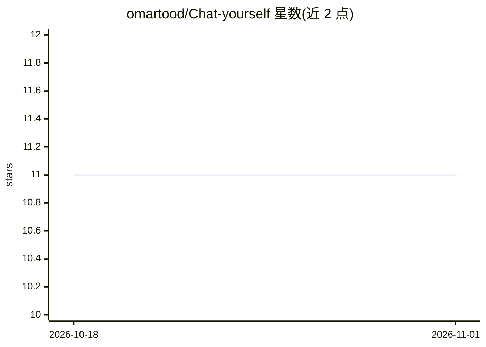

# omartood/Chat-yourself

⭐ 11 · TypeScript · 推送 2026-01-22 · [GitHub](https://github.com/omartood/Chat-yourself) · 个人维护

**面向终端用户的文档问答聊天应用：上传 PDF/DOCX 基于内容对话**

基于 Next.js 16 与 TypeScript 构建的聊天界面应用，面向希望与自己文档对话的用户。核心机制为 Memvid 长期记忆引擎：上传 PDF/DOCX 后自动抽取文本并生成 bge-small 向量嵌入（384 维），提问时按 RAG 流程检索相关片段，由 Memvid 内置 LLM 生成带来源引用的回答，支持自适应检索与流式响应。需 Node.js 18+、npm/pnpm 与 Memvid API Key（Gemini Key 可选，标注 future use），内存文件免费层容量 50 MB（约 194 篇文档）。

## 筛选速览

| 维度 | 判定 | 备注 |
|---|---|---|
| AI 角色 | `ai-native` | 本体是模型或模型工具 |
| 许可风险 | `none` | — |
| 部署形态 | `library` | 以包/库形式分发 |
| 模型依赖 | — | README 未给出锁定关系 |
| 硬件要求 | — | 无带数字的原话,不猜 |
| 安装摩擦 | `low` | 无编译、无系统依赖或容器化 |
| 成熟度 | — | 结构信号不足 |

## 能力要点

- 上传 PDF/DOCX 自动抽取文本、生成向量嵌入并建立词法索引
- RAG 检索式回答，附带来源引用
- 自适应检索按相关性分数决定使用的文档片段数量
- 支持流式响应与深色模式、移动端响应式界面

## 适用场景

- 上传自己的文档后针对内容提问或请求摘要
- 搭建个人的文档知识库问答界面
- 通过命令行查看记忆统计、上传记录与语义搜索

## 场景标签

`文档问答` · 领域:知识与检索

## 证据(README 行号)

> L3: A premium AI-powered chat interface with **long-term memory** capabilities. Built with Next.js 16 and Memvid, this a
> L15: - **RAG (Retrieval Augmented Generation)**: Answers questions based on your uploaded content
> L179: 3. The LLM generates an answer based on the retrieved context

## 星数曲线

2026-10-18 11 → 2026-11-01 11（+0）

---
*卡片 v1 · prompt 1.4 · 生成 2026-11-01 · 置信度 high · 依据 README sha `92394dc1cc4f` · [字段定义](../../DATASET.md)*
