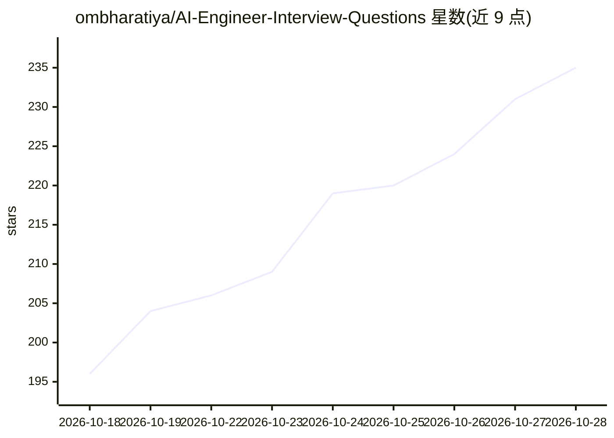

# ombharatiya/AI-Engineer-Interview-Questions

⭐ 235 · Python · MIT · 推送 2026-10-03 · [GitHub](https://github.com/ombharatiya/AI-Engineer-Interview-Questions) · [官网](https://aidaddy.tech) · 个人维护

**AI 工程师面试题库：1,172 题带答案与 33 家公司面试题**

面向准备 AI Engineer、LLM Engineer、Applied AI 面试的软件工程师与 ML 从业者的学习资源仓库：收录 1,172 道带解题的题目、13 个主题（含 RAG、微调、Agent/MCP、推理服务、安全等）、10 个系统设计案例、19 个仅依赖 numpy 与标准库的可运行 Python 编码挑战，以及 33 家公司的面试题与流程图（全部基于公开信息）。提供 'AI Engineer 75' 精选清单、按准备周期（数天至两个月）的学习计划和 10 个岗位指南，另附模拟面试与付费辅导入口。

## 筛选速览

| 维度 | 判定 | 备注 |
|---|---|---|
| AI 角色 | `ai-knowledge` | 知识聚合/清单类 |
| 许可风险 | `permissive` | MIT |
| 部署形态 | `None` |  |
| 模型依赖 | — | README 未给出锁定关系 |
| 硬件要求 | — | 无带数字的原话,不猜 |
| 安装摩擦 | `low` | 无编译、无系统依赖或容器化 |
| 成熟度 | — | 结构信号不足 |

## 能力要点

- 1,172 道题目带可折叠的解题答案，覆盖 13 个主题
- 33 家公司（前沿实验室到大厂）的面试题与流程图，基于公开信息
- 19 个仅用 numpy 与标准库的从零实现编码挑战（attention/BPE/KV cache 等）
- 'AI Engineer 75' 精选清单与按准备周期分档的学习计划

## 适用场景

- 我要系统准备 AI/LLM 工程师面试并查漏补缺
- 我想查看某家公司（如 Anthropic、DeepSeek）的面试题型
- 我想通过从零实现 attention、BPE 等练习巩固基础

## 场景标签

`教程课程` `精选清单` · 领域:学习与行业

## 证据(README 行号)

> L3:  The complete prep resource for AI Engineer, LLM Engineer, and Applied AI interviews. 1,172 questions with worked an
> L157: |#|Topic|Questions|What it covers|

## 星数曲线

2026-10-18 196 → 2026-10-28 235（+39）

---
*卡片 v1 · prompt 1.4 · 生成 2026-10-22 · 置信度 high · 依据 README sha `cf13fd5e3bd0` · [字段定义](../../DATASET.md)*
