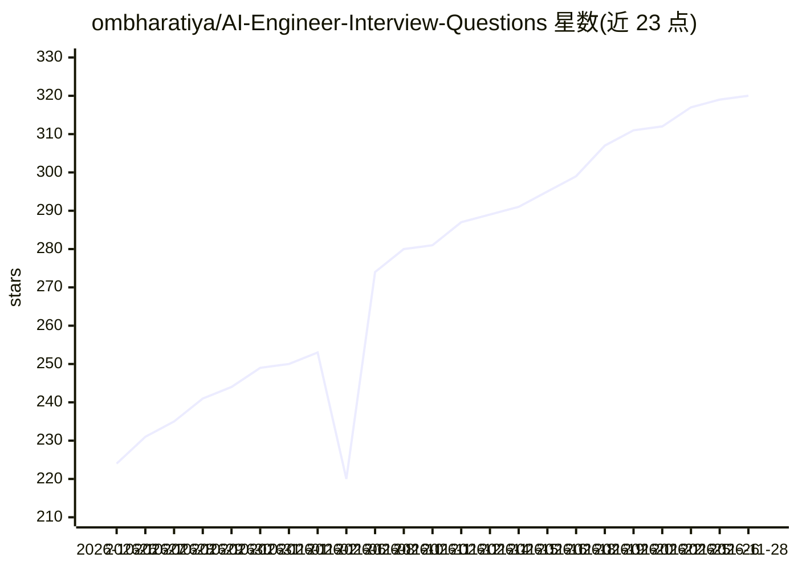

# ombharatiya/AI-Engineer-Interview-Questions

⭐ 320 · Python · MIT · 推送 2026-11-05 · [GitHub](https://github.com/ombharatiya/AI-Engineer-Interview-Questions) · [官网](https://aidaddy.tech) · 个人维护

**AI 工程师面试题库与备考路线合集，含公司真题与编程挑战**

面向 AI Engineer / LLM Engineer / Applied AI 岗位备考的内容仓库：1,254 道带解答的题目、10 个系统设计案例、19 个可运行的从零实现编程挑战、33 家公司的面试题与流程梳理、10 个岗位学习地图。内容按 13 个主题组织，每个主题含速成讲义与完整题库；提供 75 题精选清单、按时间跨度的学习计划、术语表与模拟面试工具包。编程挑战仅依赖 numpy 与标准库，直接用 python3 运行。附付费模拟面试与 1:1 辅导入口。

## 筛选速览

| 维度 | 判定 | 备注 |
|---|---|---|
| AI 角色 | `ai-knowledge` | 知识聚合/清单类 |
| 许可风险 | `permissive` | MIT |
| 部署形态 | `None` |  |
| 模型依赖 | — | README 未给出锁定关系 |
| 硬件要求 | — | 无带数字的原话,不猜 |
| 安装摩擦 | `low` | 无编译、无系统依赖或容器化 |
| 成熟度 | — | 结构信号不足 |

## 能力要点

- 1,254 道题与 13 个主题题库，解答可折叠自测
- 33 家公司面试题与 loop map，注明来源与 last reviewed
- 19 个从零实现的 Python 编程挑战，附参考实现与测试
- 按准备时长（数天到 2 个月+）的多套学习计划

## 适用场景

- 准备 AI Engineer 岗位的系统设计与编码面试
- 转岗软件工程师按角色指南规划学习路径
- 面试前用 75 题清单和 cheat sheet 快速复习
- 从零实现 attention、BPE、KV cache 等核心组件练手

## 场景标签

`精选清单` `教程课程` · 领域:学习与行业

## 证据(README 行号)

> L3:  The complete prep resource for AI Engineer, LLM Engineer, and Applied AI interviews. 1,254 questions with worked an
> L155: Each topic has a crash-course primer (`README.md`) and a full question bank with worked, collapsible answers (`que
> L192: Nineteen self-contained Python files in 12-coding-challenges, numpy and the standard library only, each with a ref

## 星数曲线

2026-10-26 224 → 2026-11-28 320（+96）

---
*卡片 v1 · prompt 1.4 · 生成 2026-11-25 · 置信度 high · 依据 README sha `855e5029338f` · [字段定义](../../DATASET.md)*
