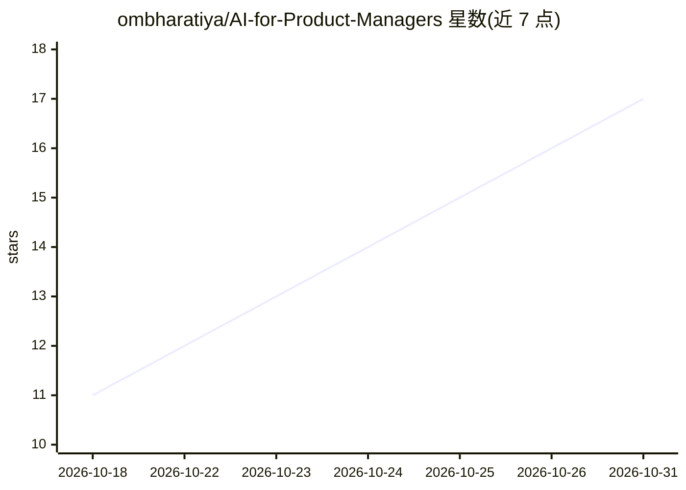

# ombharatiya/AI-for-Product-Managers

⭐ 17 · NOASSERTION · 推送 2026-07-17 · [GitHub](https://github.com/ombharatiya/AI-for-Product-Managers) · 个人维护

**AI 产品经理学习与面试准备知识库**

面向希望成为 AI 产品经理及其面试者的结构化知识库，内容涵盖 ML/LLM 基础、提示词工程、RAG、微调、agent、评测（evals）、产品策略、7 个行业领域、带来源的案例研究、150+ 面试题库与职业资源。按读者背景提供 5 条学习路径（4-16 周不等）。核心机制是事实核验标准：所有统计数据追溯到一手来源、标注日期、无法核实的声明被省略或标记，并维护一份已辟谣的常见说法清单。内容以文档形式组织，CC BY 4.0 许可。

## 筛选速览

| 维度 | 判定 | 备注 |
|---|---|---|
| AI 角色 | `ai-knowledge` | 知识聚合/清单类 |
| 许可风险 | `none` | NOASSERTION |
| 部署形态 | `None` |  |
| 模型依赖 | — | README 未给出锁定关系 |
| 硬件要求 | — | 无带数字的原话,不猜 |
| 安装摩擦 | `low` | 无编译、无系统依赖或容器化 |
| 成熟度 | — | 结构信号不足 |

## 能力要点

- 5 条按背景定制的学习路径与 AI PM 技能图
- 150+ 面试题，按来源区分（真实报告 vs 练习题）
- 事实核验标准：统计数据溯源、日期戳、辟谣清单
- 覆盖 7 个行业领域与带来源的案例研究

## 适用场景

- 转岗或求职 AI 产品经理岗时系统学习与备考
- 面试前突击准备（30 天冲刺路径）
- 查找带来源可引用的 AI 产品行业数据与案例

## 场景标签

`教程课程` · 领域:学习与行业

## 证据(README 行号)

> L3: ### The complete, verified, no-hallucination guide to becoming an AI Product Manager, and passing the interviews.
> L74: ### 07 · Interview Prep

## 星数曲线

2026-10-18 11 → 2026-10-31 17（+6）

---
*卡片 v1 · prompt 1.4 · 生成 2026-10-30 · 置信度 high · 依据 README sha `b60499e90531` · [字段定义](../../DATASET.md)*
