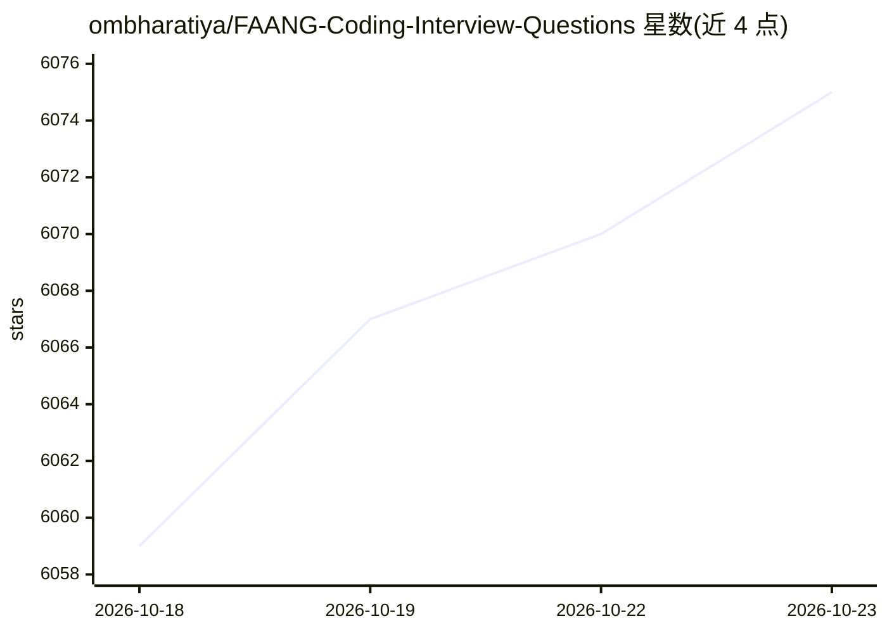

# ombharatiya/FAANG-Coding-Interview-Questions

⭐ 6,075 · GPL-3.0 · 推送 2026-10-08 · [GitHub](https://github.com/ombharatiya/FAANG-Coding-Interview-Questions) · [官网](https://www.aidaddy.tech) · 个人维护

**FAANG/AI 实验室编程面试题策展清单，覆盖 44 家公司**

策展型面试题资源库：收录 2025-2026 年 44 家公司（FAANG、DeepMind/xAI/Mistral 等前沿 AI 实验室、AI 创业公司）的编程题、系统设计与 ML 面试题。题表含题号、难度、类别、时间/空间复杂度（如 Google 45 题、Meta 45 题及 FAANG 必做 30 题）。另记录 2026 年各公司 AI 辅助面试轮的变化（Meta 三面板 CoderPad、OpenAI agentic coding 轮等），并提供分阶段备考路线（初级/中级/高级/AI Lab 轨道）。维护者另提供付费模拟面试与 1:1 辅导链接。

## 筛选速览

| 维度 | 判定 | 备注 |
|---|---|---|
| AI 角色 | `ai-knowledge` | 知识聚合/清单类 |
| 许可风险 | `viral` | GPL-3.0 |
| 部署形态 | `None` |  |
| 模型依赖 | — | README 未给出锁定关系 |
| 硬件要求 | — | 无带数字的原话,不猜 |
| 安装摩擦 | `medium` | 含编译或系统依赖之一 |
| 成熟度 | — | 结构信号不足 |

## 能力要点

- 44 家公司的 2025-2026 面试题策展，含难度与复杂度标注
- AI Lab 专门轨道：OpenAI/Anthropic/DeepMind 等面试流程说明
- 2026 年各公司 AI 辅助面试轮变化记录
- 四档备考路线（初级/中级/高级/AI Lab）

## 适用场景

- 准备 FAANG/MAANG 编程面试刷题
- 了解 AI 实验室与 AI 创业公司的面试形式
- 按公司查看高频题与 2026 年流程变化

## 场景标签

`精选清单` · 领域:学习与行业

## 证据(README 行号)

> L3:  A curated collection of coding, system design, and ML interview questions from top tech companies. Continuously upd
> L30: - AI Labs & AI Companies Interview Questions: DeepMind, xAI, Mistral, Perplexity, Scale AI, Cohere, Cursor, Waymo a

## 星数曲线

2026-10-18 6,059 → 2026-10-23 6,075（+16）

---
*卡片 v1 · prompt 1.4 · 生成 2026-10-20 · 置信度 high · 依据 README sha `60ab349304c1` · [字段定义](../../DATASET.md)*
