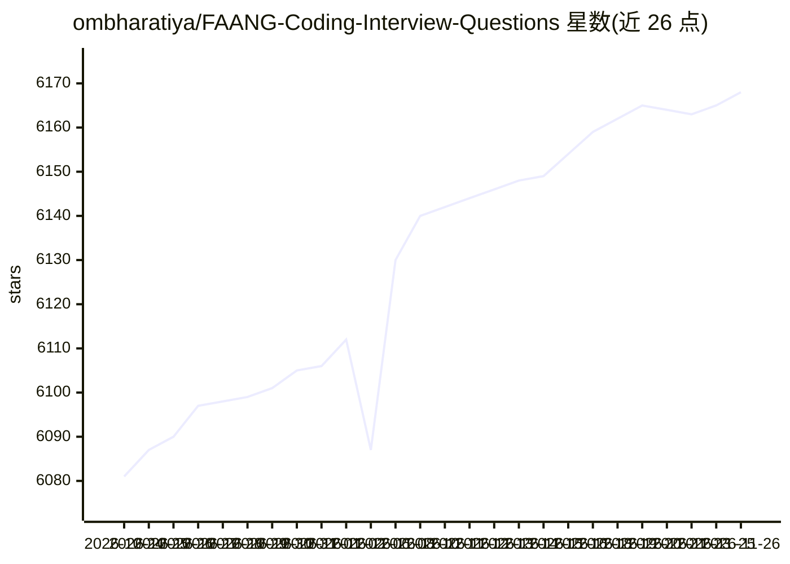

# ombharatiya/FAANG-Coding-Interview-Questions

⭐ 6,168 · GPL-3.0 · 推送 2026-11-01 · [GitHub](https://github.com/ombharatiya/FAANG-Coding-Interview-Questions) · [官网](https://www.aidaddy.tech) · 个人维护

**面向求职者的 FAANG/AI 实验室面试题策展清单（44 家公司）**

持续更新的编程、系统设计与机器学习面试题清单，覆盖 FAANG、前沿 AI 实验室与 AI 初创公司共 44 家，收录高频算法题表格（含难度与复杂度）、公司专属题目、NeetCode 150/Blind 75 等资源索引，以及按初级/中级/高级/AI 实验室路线组织的学习路径。2026 版补充各公司 AI 辅助面试环节的政策差异（允许/禁止/试点情况）。以纯文档清单形式提供，附带维护者的付费模拟面试与一对一辅导入口。

## 筛选速览

| 维度 | 判定 | 备注 |
|---|---|---|
| AI 角色 | `ai-knowledge` | 知识聚合/清单类 |
| 许可风险 | `viral` | GPL-3.0 |
| 部署形态 | `None` |  |
| 模型依赖 | — | README 未给出锁定关系 |
| 硬件要求 | — | 无带数字的原话,不猜 |
| 安装摩擦 | `medium` | 含编译或系统依赖之一 |
| 成熟度 | — | 结构信号不足 |

## 能力要点

- 覆盖 44 家公司的 2025-2026 面试题与公司专属题目分类
- 30 道 FAANG 必做题表格（含难度、时间/空间复杂度）
- AI 实验室面试专项指南：从零实现 attention/tokenizer/采样、调试轮次准备
- 记录 Meta/Google/OpenAI/Anthropic 等公司 AI 辅助面试环节政策

## 适用场景

- 准备 FAANG/MAANG 的算法与系统设计面试
- 备考 OpenAI、Anthropic、DeepMind 等 AI 实验室的工程岗位
- 按阶段路线规划 0-6 个月的刷题计划
- 了解目标公司是否允许 AI 辅助及面试流程变化

## 场景标签

`精选清单` `教程课程` · 领域:学习与行业

## 证据(README 行号)

> L3:  A curated collection of coding, system design, and ML interview questions from top tech companies. Continuously upd
> L33: **AI & Machine Learning**
> L93: ## FAANG Must Do Problems

## 星数曲线

2026-10-24 6,081 → 2026-11-26 6,168（+87）

---
*卡片 v1 · prompt 1.4 · 生成 2026-11-23 · 置信度 high · 依据 README sha `53fd6aac9fdb` · [字段定义](../../DATASET.md)*
