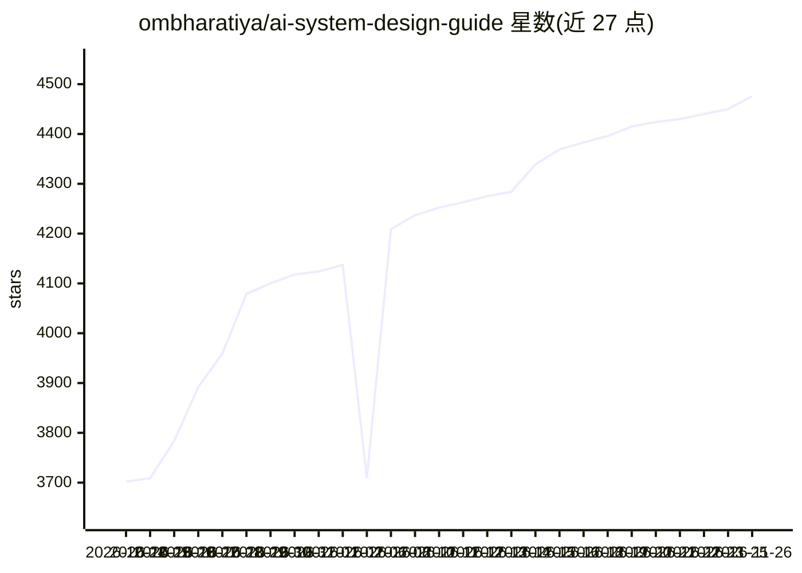

# ombharatiya/ai-system-design-guide

⭐ 4,476 · MIT · 推送 2026-11-10 · [GitHub](https://github.com/ombharatiya/ai-system-design-guide) · [官网](https://www.aidaddy.tech) · 个人维护

**面向工程师的生产级 AI 系统设计与面试参考指南**

一份持续更新的 AI 系统设计指南，覆盖 RAG 架构、LLM 工程、agentic AI、MCP/A2A 协议与评测，按 AI 系统生命周期组织章节，并附 193 题面试题库、答案框架、白板练习与 15 个带完整解法的案例研究。目标读者是构建生产 AI 系统和准备 staff 级别面试的工程师。提供在线阅读站点，另有两份各 3,000+ 行的 AI 评测配套指南（Phoenix/Langfuse、LangWatch/Langfuse）。MIT 许可、接受 PR，不含可运行代码安装流程，定位为文档参考。

## 筛选速览

| 维度 | 判定 | 备注 |
|---|---|---|
| AI 角色 | `ai-knowledge` | 知识聚合/清单类 |
| 许可风险 | `permissive` | MIT |
| 部署形态 | `None` |  |
| 模型依赖 | — | README 未给出锁定关系 |
| 硬件要求 | — | 无带数字的原话,不猜 |
| 安装摩擦 | `low` | 无编译、无系统依赖或容器化 |
| 成熟度 | — | 结构信号不足 |

## 能力要点

- 193 题面试题库、答案框架与 10 个白板练习
- 15 个真实面试案例研究，含问题与解法图表
- 按 AI 系统生命周期阶段组织的章节结构
- 两份 3,000+ 行的 AI 评测深度指南（LLM-as-a-Judge、RAG 评测等）

## 适用场景

- 准备 AI/LLM 系统设计的 staff 级别面试
- 设计生产级 RAG 与 agent 架构时查找模式与权衡
- 为生产环境选择与评测 LLM
- 从现有岗位转型到 AI 工程方向

## 场景标签

`教程课程` · 领域:学习与行业

## 证据(README 行号)

> L25: A practical, continuously updated guide to AI system design, RAG architectures, LLM engineering, agentic AI, MCP an
> L98: - A staff-level reference for designing production AI systems (RAG, agents, MCP, eval pipelines, multi-tenant isola
> L99: - An interview-prep companion with 193 real questions (including a Voice AI set and a set built from recent candida

## 星数曲线

2026-10-24 3,702 → 2026-11-26 4,476（+774）

---
*卡片 v1 · prompt 1.4 · 生成 2026-11-22 · 置信度 high · 依据 README sha `5208dba45db0` · [字段定义](../../DATASET.md)*
