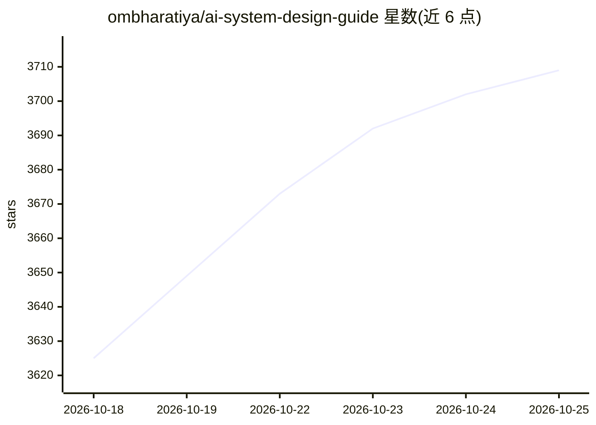

# ombharatiya/ai-system-design-guide

⭐ 3,784 · MIT · 推送 2026-10-08 · [GitHub](https://github.com/ombharatiya/ai-system-design-guide) · [官网](https://www.aidaddy.tech) · 个人维护

**面向工程师的 AI 系统设计与面试参考指南（持续更新文档）**

持续更新的活文档型参考指南，覆盖 RAG 架构、agent 编排、MCP/A2A 协议、模型选型（含定价）、评测与生产案例研究，并附 147 题面试题库与答案框架。面向构建生产 AI 系统的工程师及准备 AI 系统设计面试的候选人；不涵盖 Python/PyTorch 基础教学。MIT 许可、接受 PR，配套在线阅读站点与付费模拟面试服务（后者为独立商业服务）。

## 筛选速览

| 维度 | 判定 | 备注 |
|---|---|---|
| AI 角色 | `ai-knowledge` | 知识聚合/清单类 |
| 许可风险 | `permissive` | MIT |
| 部署形态 | `None` |  |
| 模型依赖 | — | README 未给出锁定关系 |
| 硬件要求 | — | 无带数字的原话,不猜 |
| 安装摩擦 | `low` | 无编译、无系统依赖或容器化 |
| 成熟度 | — | 结构信号不足 |

## 能力要点

- 147 题面试题库、答案框架与十个白板练习
- 15 个生产案例研究（多租户 RAG、eval 门控 CI/CD、蒸馏降本等）
- 含 2026 年 10 月模型定价与选型对照
- 两份评测深度指南（Phoenix/Langfuse、LangWatch/Langfuse）

## 适用场景

- 准备 AI 工程与系统设计面试
- 构建生产 RAG / agent 系统时查阅模式与权衡
- 评测体系搭建与平台选型参考
- 跟踪模型发布与协议变化

## 场景标签

`教程课程` · 领域:学习与行业

## 证据(README 行号)

> L25: A practical, continuously updated guide to AI system design, RAG architectures, LLM engineering, agentic AI, MCP an
> L97: - A staff-level reference for designing production AI systems (RAG, agents, MCP, eval pipelines, multi-tenant isola
> L98: - An interview-prep companion with 147 real questions (including a Voice AI set), answer frameworks with a worked m

## 星数曲线

2026-10-18 3,625 → 2026-10-25 3,709（+84）

---
*卡片 v1 · prompt 1.4 · 生成 2026-10-20 · 置信度 high · 依据 README sha `dde933ef7d2e` · [字段定义](../../DATASET.md)*
