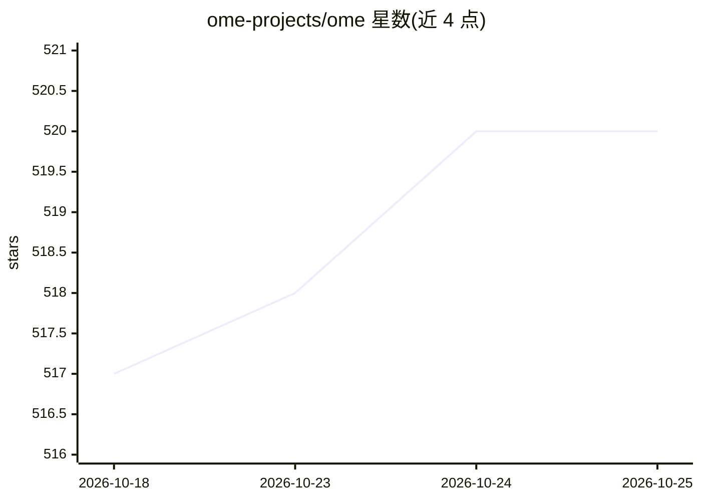

# ome-projects/ome

⭐ 520 · Go · Apache-2.0 · 推送 2026-10-24 · [GitHub](https://github.com/ome-projects/ome) · [官网](http://ome-projects.github.io/ome/) · 组织维护

**面向企业的 LLM 服务 Kubernetes Operator：模型管理与 GPU 调度**

Kubernetes operator，以自定义资源（BaseModel、ServingRuntime、InferenceService、AcceleratorClass 等）管理 LLM 的部署与运维：自动解析模型文件、按架构/量化/参数量加权选择运行时、GPU bin-packing 调度，支持预填充-解码分离、多节点推理、金丝雀/蓝绿发布与 BenchmarkJob 压测。运行时集成 SGLang 与 vLLM，内置 200+ 预配置模型目录，提供 kubectl ome CLI 与独立开发的 Web 控制台。要求 Kubernetes 1.28+，Fleet 容量管理等功能标注 alpha，Apache-2.0 许可。

## 筛选速览

| 维度 | 判定 | 备注 |
|---|---|---|
| AI 角色 | `ai-ecosystem` | LLM/agent 周边工具 |
| 许可风险 | `permissive` | Apache-2.0 |
| 部署形态 | `library` | 以包/库形式分发 |
| 模型依赖 | local-ok | 支持本地模型 |
| 硬件要求 | — | 无带数字的原话,不猜 |
| 安装摩擦 | `low` | 无编译、无系统依赖或容器化 |
| 成熟度 | `idea` | |

## 能力要点

- 模型作为一等自定义资源，自动解析架构/参数量并支持多格式（SafeTensors/PyTorch/TensorRT/ONNX）
- SGLang 与 vLLM 运行时集成，支持预填充-解码分离与多节点推理
- GPU bin-packing 调度与 AcceleratorClass 硬件感知选卡策略
- kubectl ome CLI 与 BenchmarkJob 自动化压测

## 适用场景

- 在 Kubernetes 集群上部署和运维大规模 LLM 推理服务
- 管理 GPU 资源池并按成本/性能策略调度推理负载
- 对模型服务做金丝雀发布、压测与性能对比

## 场景标签

`推理引擎` · 领域:训练与推理

## 证据(README 行号)

> L14: OME (Open Model Engine) is a Kubernetes operator for enterprise-grade management and serving of Large Language Mode
> L28: - **Runtime Integrations:** First-class support for **SGLang** - the most advanced inference engine with cache-awar

## 星数曲线

2026-10-18 517 → 2026-10-25 520（+3）

---
*卡片 v1 · prompt 1.4 · 生成 2026-10-22 · 置信度 high · 依据 README sha `d418a832a3b2` · [字段定义](../../DATASET.md)*
