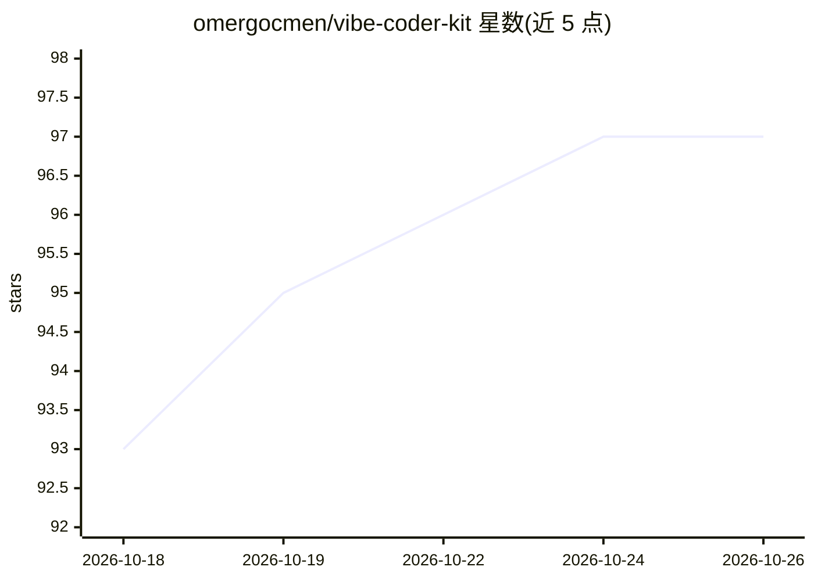

# omergocmen/vibe-coder-kit

⭐ 97 · MIT · 推送 2026-06-04 · [GitHub](https://github.com/omergocmen/vibe-coder-kit) · 个人维护

**把 AI 代码助手配置成结构化开发团队的 agent 框架**

面向 OpenCode 等 AI 代码助手的配置型 agent 框架：提供 4 个专家人格（设计师/Frontend/Backend/DevOps）、12 个结构化技能（从头脑风暴到事件响应）、3 套规则（代码卫生/质量/安全）与跨会话持久知识库。通过 git clone 复制配置文件到现有项目或作为新项目起点；OpenCode 自动读取 AGENTS.md 并运行 project-context-primer 技能。所有 agent 指令与文档用土耳其语编写（附英文 frontmatter），可迁移到 Cursor、Claude Code、GitHub Copilot、Windsurf。

## 筛选速览

| 维度 | 判定 | 备注 |
|---|---|---|
| AI 角色 | `ai-ecosystem` | LLM/agent 周边工具 |
| 许可风险 | `permissive` | MIT |
| 部署形态 | `library` | 以包/库形式分发 |
| 模型依赖 | — | README 未给出锁定关系 |
| 硬件要求 | — | 无带数字的原话,不猜 |
| 安装摩擦 | `low` | 无编译、无系统依赖或容器化 |
| 成熟度 | — | 结构信号不足 |

## 能力要点

- 4 个专家 agent 人格与 12 个结构化技能、3 套规则
- 跨会话持久知识库（决策/约定/bug/gotcha/研究五类记录）
- OpenCode 原生支持，AGENTS.md 自动加载
- 兼容 Cursor、Claude Code、GitHub Copilot、Windsurf 迁移使用

## 适用场景

- 为我的 AI 代码助手建立结构化的开发流程与角色分工
- 跨会话保留项目决策与踩坑记录
- 给团队统一代码质量与安全规则

## 场景标签

`Agent 框架` · 领域:Agent 开发

## 证据(README 行号)

> L13: Vibe Coder Kit, AI kod asistanlarını (ör. OpenCode) yapılandırılmış, süreç odaklı bir geliştirme ekibine dönüştüren
> L171: |**OpenCode**|`opencode.json` + `AGENTS.md` ile doğal destek|

## 星数曲线

2026-10-18 93 → 2026-10-26 97（+4）

---
*卡片 v1 · prompt 1.4 · 生成 2026-10-23 · 置信度 mid · 依据 README sha `82b6f0e14d49` · [字段定义](../../DATASET.md)*
