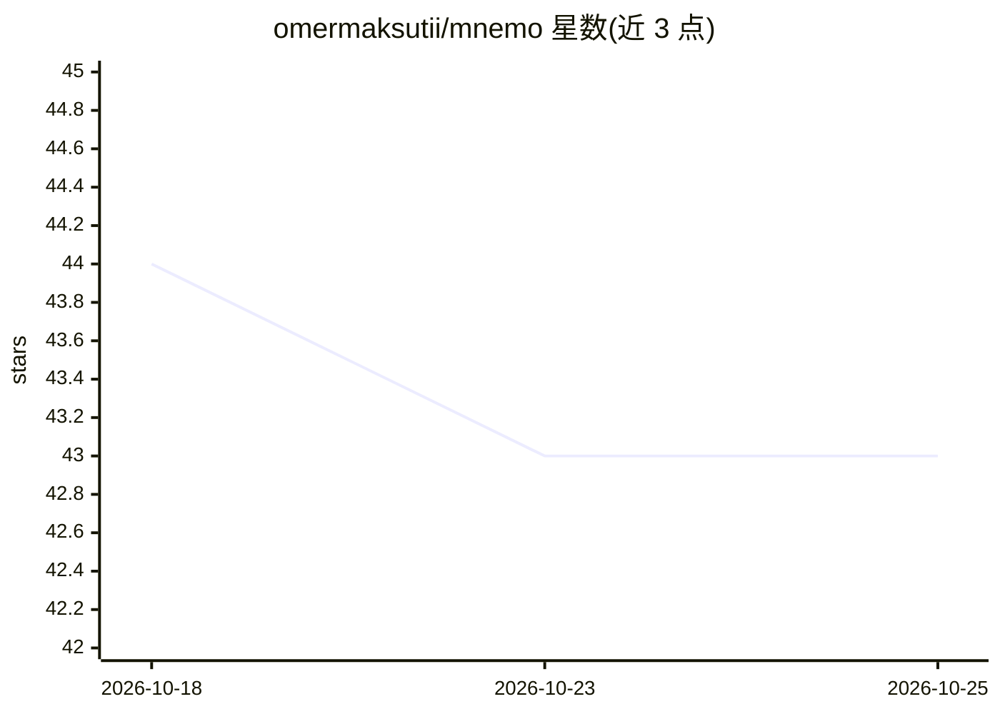

# omermaksutii/mnemo

⭐ 43 · TypeScript · MIT · 推送 2026-06-17 · [GitHub](https://github.com/omermaksutii/mnemo) · 个人维护

**为 Claude Code 提供跨会话持久语义记忆的 MCP 工具**

面向 Claude Code（及 Cursor、aider 等多个 agent）的本地优先持久记忆系统：通过 post-edit 钩子自动捕获决策与偏好，以嵌入加 HNSW 实现亚百毫秒语义检索，按余弦相似度、新近度与访问频次加权打分（0.7/0.2/0.1）。提供 CLI、9 工具 MCP 服务器、知识图谱实体关联、端到端加密的多机同步后端与插件机制，存储可用 AES-256-GCM 静态加密。作为对照，README 将其与静态加载的 CLAUDE.md 方式并列说明容量与检索差异。

## 筛选速览

| 维度 | 判定 | 备注 |
|---|---|---|
| AI 角色 | `ai-ecosystem` | LLM/agent 周边工具 |
| 许可风险 | `permissive` | MIT |
| 部署形态 | `library` | 以包/库形式分发 |
| 模型依赖 | — | README 未给出锁定关系 |
| 硬件要求 | — | 无带数字的原话,不猜 |
| 安装摩擦 | `low` | 无编译、无系统依赖或容器化 |
| 成熟度 | — | 结构信号不足 |

## 能力要点

- 按语义按需召回的持久记忆，宣称 sub-100ms 检索
- 自动捕获钩子：CLAUDE.md/ADR 文档变更即入库
- 知识图谱实体创建、关联与依赖查询
- 端到端加密的多机同步，服务端只见密文

## 适用场景

- 让 Claude Code 跨会话保留项目决策与个人偏好
- 用终端命令手动记忆和召回条目
- 多台机器间同步加密记忆库

## 场景标签

`Agent 记忆` · 领域:Agent 开发

## 证据(README 行号)

> L82:   ├── @mnemo-mcp/server server          ← exposes recall/remember/forget/list/stats
> L111: @mnemo-mcp/server       — MCP server (drop into Claude Code; 9 tools)

## 星数曲线

2026-10-18 44 → 2026-10-25 43（-1）

---
*卡片 v1 · prompt 1.4 · 生成 2026-10-25 · 置信度 high · 依据 README sha `a81628e58f91` · [字段定义](../../DATASET.md)*
