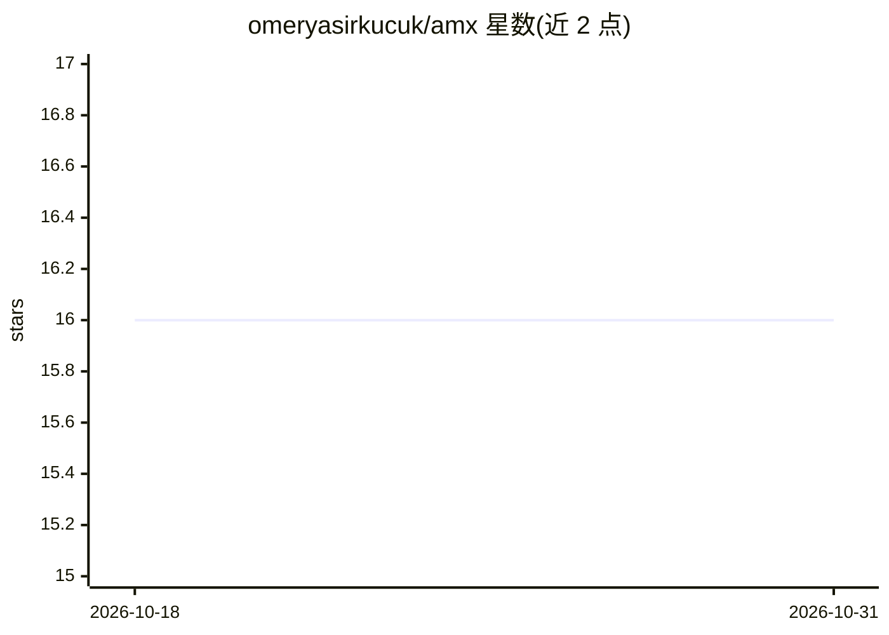

# omeryasirkucuk/amx

⭐ 16 · Python · Apache-2.0 · 推送 2026-10-22 · [GitHub](https://github.com/omeryasirkucuk/amx) · [官网](https://amxcli.com) · 个人维护

**给数据团队的 CLI：用 LLM 为数据库表和列起草注释**

AMX 是一个 Python CLI 工具，面向需要为数据库编写文档的数据工程与数据团队：三个独立子代理（Profile 读 schema 与统计、RAG 读摄入文档、Code 从代码仓库挖掘引用）并行收集证据，由编排器合并排序后为每个表、视图和列生成带置信度的 COMMENT 建议，经人工接受/编辑/跳过后以原生 DDL 写回数据库。支持 10 种数据库后端和 7 类 LLM 提供商（含 OpenAI 兼容端点），并附本地 Web UI（AMX Studio）。README 声明处于早期开发阶段，版本间可能有破坏性变更；需 Python 3.10+。

## 筛选速览

| 维度 | 判定 | 备注 |
|---|---|---|
| AI 角色 | `ai-native` | 本体是模型或模型工具 |
| 许可风险 | `permissive` | Apache-2.0 |
| 部署形态 | `desktop` | 安装包/桌面程序 |
| 模型依赖 | local-ok | 支持本地模型 |
| 硬件要求 | — | 无带数字的原话,不猜 |
| 安装摩擦 | `low` | 无编译、无系统依赖或容器化 |
| 成熟度 | `idea` | |

## 能力要点

- Profile/RAG/Code 三子代理并行收集证据，编排器排序建议
- 人工在环审阅：接受/编辑/跳过，仅写回已批准的 COMMENT
- 支持 10 种数据库后端（PostgreSQL、Snowflake、Databricks、BigQuery 等）
- 支持 7 类 LLM 提供商及任意 OpenAI 兼容端点，可本地运行

## 适用场景

- 为缺少注释的数据仓库批量起草列级文档
- 结合 dbt 之外的业务代码与文档推断字段含义
- 在批准前逐条审阅 AI 生成的数据库注释

## 场景标签

 · 领域:数据工程/数据目录

## 证据(README 行号)

> L19: Three independent sub-agents — **Profile** (schema, stats, sample values), **RAG** (ingested docs), and **Code** (r
> L92: OpenAI · Anthropic · Google Gemini · DeepSeek · OpenRouter · Ollama · vLLM / LM Studio · any OpenAI-compatible endp

## 星数曲线

2026-10-18 16 → 2026-10-31 16（+0）

---
*卡片 v1 · prompt 1.4 · 生成 2026-10-30 · 置信度 high · 依据 README sha `31648e5c1c26` · [字段定义](../../DATASET.md)*
