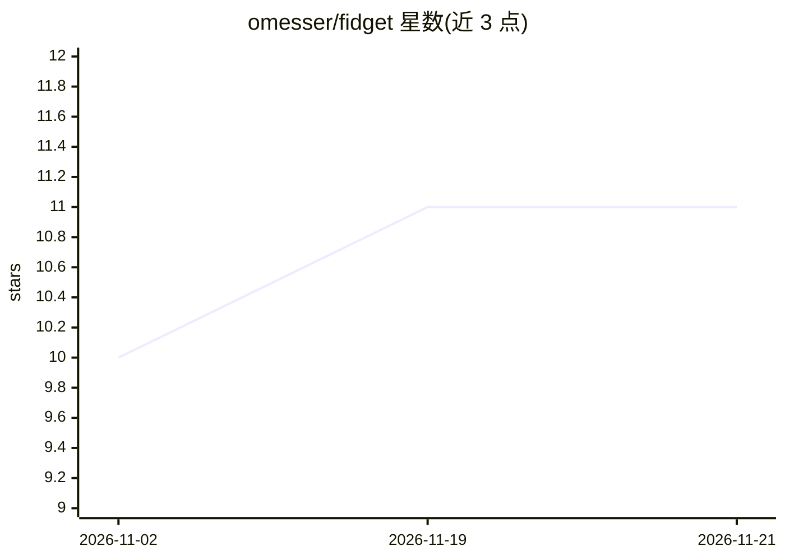

# omesser/fidget

⭐ 11 · Rust · MIT · 推送 2026-11-19 · [GitHub](https://github.com/omesser/fidget) · [官网](https://omesser.github.io/fidget/) · 个人维护

**桌面宠物应用：可挂接已有 AI harness 协助工作**

Fidget 是一个屏幕桌面宠物（desktop pet），角色在桌面上行走、打盹、可被拿起抛掷。默认离线运行，无需 AI 账号；用户可在设置中挂接已有的 AI harness（Claude Code、Codex、Cursor 或任意 ACP harness）或 Model API（预设 OpenAI、Anthropic、xAI、Ollama 的 Base URL），使其具备对话与工具调用能力。支持 11 个内置角色、自定义 Instance Prompt、导入角色 ZIP；基于 Rust 与 Tauri 构建，隐私上默认不截屏、不读屏幕像素，窗口标题与应用名需用户同意后才读取。

## 筛选速览

| 维度 | 判定 | 备注 |
|---|---|---|
| AI 角色 | `ai-enhanced` | 去掉 AI 部分产品仍成立 |
| 许可风险 | `permissive` | MIT |
| 部署形态 | `desktop` | 安装包/桌面程序 |
| 模型依赖 | local-ok | 支持本地模型 |
| 硬件要求 | — | 无带数字的原话,不猜 |
| 安装摩擦 | `low` | 无编译、无系统依赖或容器化 |
| 成熟度 | — | 结构信号不足 |

## 能力要点

- 离线模式可用，AI harness 为可选挂接项
- 支持 Claude Code、Codex、Cursor 及任意 ACP harness，或 OpenAI 兼容 Model API
- 11 个内置角色，通过纯文本性格文件与 manifest 自定义
- 不截屏、不读像素，窗口标题读取需用户同意

## 适用场景

- 在桌面上养一只可互动的宠物，离线也可用
- 挂接已有 AI agent，通过双击聊天让它代为操作
- 自定义角色性格与行为提示词
- 全自动全屏隐藏、快捷键隐藏等桌面陪伴场景

## 场景标签

`AI 助手` · 领域:对话与助手

## 证据(README 行号)

> L9: # Fidget is a desktop pet that keeps you company, and pitches in when you ask
> L15: An AI harness is optional. Attach the one you already use and it can talk and pitch in with tools; leave it off and
> L27: - **Keeps you company:** It walks, naps, and reacts to your open windows. It works offline, with no AI account or s

## 星数曲线

2026-11-02 10 → 2026-11-21 11（+1）

---
*卡片 v1 · prompt 1.4 · 生成 2026-11-19 · 置信度 mid · 依据 README sha `cde1abf5ab62` · [字段定义](../../DATASET.md)*
