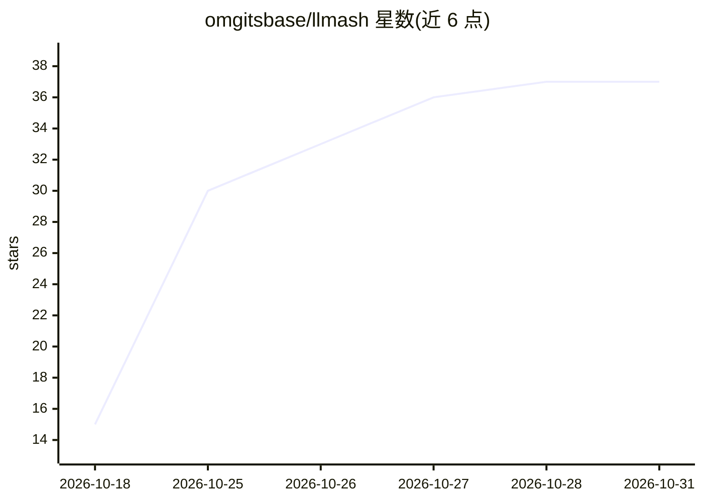

# omgitsbase/llmash

⭐ 37 · C++ · Apache-2.0 · 推送 2026-10-30 · [GitHub](https://github.com/omgitsbase/llmash) · 个人维护

**Ollama 兼容的本地 LLM 服务器与命令行，基于调优 llama.cpp 分叉**

面向本地模型使用者的推理服务器与 CLI，运行在 llama.cpp 分叉之上，保持 Ollama 的命令、API 与模型存储，已指向 Ollama 的应用无需改动即可切换。运行时加入每投机轮单一 CUDA 图、4-bit 草稿头、融合递归层与 MoE 尾部等内核，提供 RCO-3 三位宽构建与 NVFP4 支持，并附对比基准与数学准确率测试。安装为 Windows/Linux 一键脚本，NVIDIA Turing 及以上显卡配 CUDA 13 运行时，其余走 Vulkan/CPU。支持 Hugging Face 拉取、GGUF 目录读取及分类器模型。

## 筛选速览

| 维度 | 判定 | 备注 |
|---|---|---|
| AI 角色 | `ai-ecosystem` | LLM/agent 周边工具 |
| 许可风险 | `permissive` | Apache-2.0 |
| 部署形态 | `self-host` | docker 或自建部署 |
| 模型依赖 | local-ok | 支持本地模型 |
| 硬件要求 | — | 无带数字的原话,不猜 |
| 安装摩擦 | `low` | 无编译、无系统依赖或容器化 |
| 成熟度 | — | 结构信号不足 |

## 能力要点

- 保持 Ollama 的命令、API 与模型存储，兼容已有接入
- 自定义 CUDA 内核与 MTP 投机解码，提供 RCO-3 三位宽构建
- 支持 Hugging Face 仓库拉取与本地 GGUF 文件夹直读
- 可运行 text-classification 分类器模型（0.5.2 起）

## 适用场景

- 替换 Ollama 作为本地推理后端而保持现有工具链不变
- 在 NVIDIA 显卡上以 3-bit 构建运行较大模型
- 读取 LM Studio 或 llama.cpp 的 GGUF 目录运行模型

## 场景标签

`推理引擎` · 领域:训练与推理

## 证据(README 行号)

> L12: An Ollama-compatible server and command line for Windows and Linux, built on a
> L13: fork of llama.cpp. It keeps Ollama's commands, API and model store, so anything
> L200: The runtime is a llama.cpp fork the installer fetches beside the program, and

## 星数曲线

2026-10-18 15 → 2026-10-31 37（+22）

---
*卡片 v1 · prompt 1.4 · 生成 2026-10-25 · 置信度 mid · 依据 README sha `8ba0aff63c5b` · [字段定义](../../DATASET.md)*
