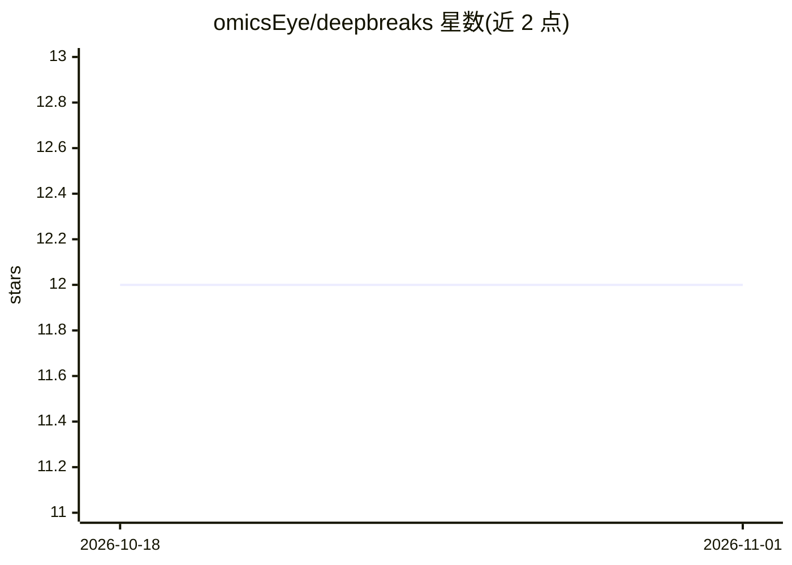

# omicsEye/deepbreaks

⭐ 12 · Jupyter Notebook · 推送 2026-08-12 · [GitHub](https://github.com/omicsEye/deepbreaks) · 组织维护

**从多序列比对数据识别与表型关联的基因组位点工具**

面向群体遗传学分析的命令行与 Python 软件：读取多序列比对（MSA）文件与表型元数据，通过随机森林、Adaboost、XGBoost 等多个机器学习模型比较与特征重要性排序，定位与目标表型显著关联的序列位点，输出特征重要性 CSV、可视化图表、模型 pickle 与 p 值。支持回归与分类任务，可自定义模型、超参数与评价指标。提供 conda/pip 安装、Docker 镜像及 Opsin、口腔微生物组、SARS-CoV-2 变体等示例。

## 筛选速览

| 维度 | 判定 | 备注 |
|---|---|---|
| AI 角色 | `ai-native` | 本体是模型或模型工具 |
| 许可风险 | `none` | — |
| 部署形态 | `self-host` | docker 或自建部署 |
| 模型依赖 | — | README 未给出锁定关系 |
| 硬件要求 | — | 无带数字的原话,不猜 |
| 安装摩擦 | `low` | 无编译、无系统依赖或容器化 |
| 成熟度 | — | 结构信号不足 |

## 能力要点

- 多模型比较与特征重要性排序定位关联位点
- 支持回归与分类任务，可自定义模型/超参数/指标
- 输出特征重要性 CSV、图表、pickle 模型与 p 值
- 提供 Docker 镜像与多个真实数据集教程

## 适用场景

- 我想找出与特定表型相关的氨基酸或核苷酸位点
- 分析微生物基因组与栖息环境的关联
- 定位 SARS-CoV-2 变体 spike 蛋白的关键突变区域

## 场景标签

 · 领域:生物信息学/基因组学

## 证据(README 行号)

> L3: ***deepBreaks*** , a computational method, aims to identify important
> L26:   title = {deepBreaks identifies and prioritizes genotype–phenotype associations using machine learning},

## 星数曲线

2026-10-18 12 → 2026-11-01 12（+0）

---
*卡片 v1 · prompt 1.4 · 生成 2026-11-01 · 置信度 high · 依据 README sha `80b5333e1fee` · [字段定义](../../DATASET.md)*
