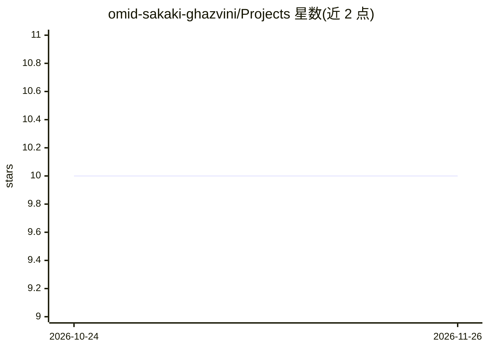

# omid-sakaki-ghazvini/Projects

⭐ 10 · Jupyter Notebook · 推送 2026-11-14 · [GitHub](https://github.com/omid-sakaki-ghazvini/Projects) · [官网](https://omidsakaki.ir/) · 个人维护

**AI 学习项目集：TensorFlow/PyTorch 笔记本覆盖 CV/NLP 等**

收录约 24 个以 Jupyter Notebook 形式呈现的 AI 项目，每条含标题、类别、数据集、描述与笔记本链接，覆盖计算机视觉、NLP、时间序列、推荐系统、强化学习等方向，涉及图像分类/检测/分割、GAN 图像生成、BERT 微调、LLM 聊天机器人、RAG 系统构建等。技术栈为 TensorFlow 与 PyTorch，部分项目使用 HuggingFace 与 LangChain，含多个波斯语数据集项目。仓库本身不含安装说明，为个人作品展示性质的项目索引。

## 筛选速览

| 维度 | 判定 | 备注 |
|---|---|---|
| AI 角色 | `ai-knowledge` | 知识聚合/清单类 |
| 许可风险 | `none` | — |
| 部署形态 | `None` |  |
| 模型依赖 | — | README 未给出锁定关系 |
| 硬件要求 | — | 无带数字的原话,不猜 |
| 安装摩擦 | `low` | 无编译、无系统依赖或容器化 |
| 成熟度 | — | 结构信号不足 |

## 能力要点

- 24 个左右 Jupyter Notebook 项目，按标题/类别/数据集/描述列表组织
- 技术栈覆盖 TensorFlow 与 PyTorch
- 任务覆盖分类、检测、分割、生成、推荐、强化学习、RAG
- 含波斯语 NLP 与车牌检测等本地化数据集项目

## 适用场景

- 查找某个 CV/NLP 任务的可运行 notebook 示例
- 学习 TensorFlow 或 PyTorch 的项目级实践
- 参考波斯语文本分类、车牌检测等本地化数据集做法

## 场景标签

`教程课程` · 领域:学习与行业

## 证据(README 行号)

> L2:  Artificial Intelligence Projects with TensorFlow and PyTorch in Jupyter Notebooks.
> L4:  Title

## 星数曲线

2026-10-24 10 → 2026-11-26 10（+0）

---
*卡片 v1 · prompt 1.4 · 生成 2026-11-19 · 置信度 high · 依据 README sha `e62a1851f355` · [字段定义](../../DATASET.md)*
