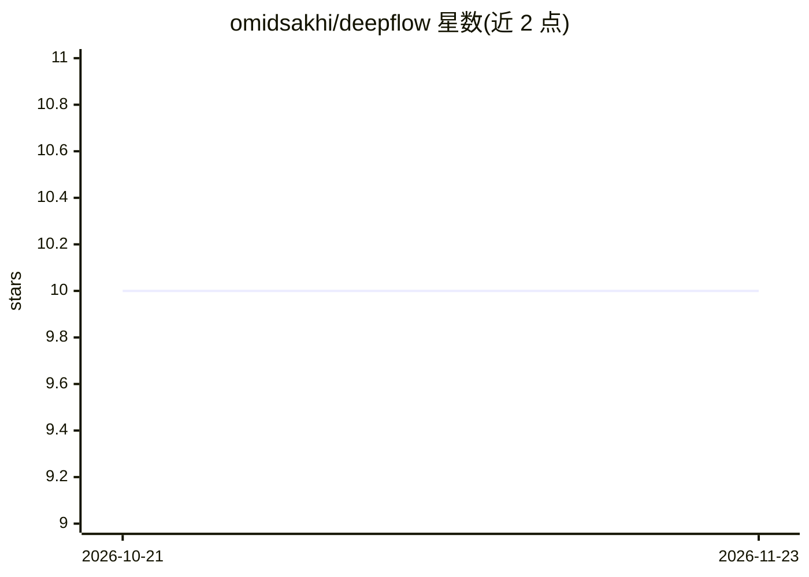

# omidsakhi/deepflow

⭐ 10 · C++ · BSD-3-Clause · 推送 2026-04-23 · [GitHub](https://github.com/omidsakhi/deepflow) · 个人维护

**C++/CUDA 从零实现的深度学习框架，附 GAN/VAE 生成人脸示例**

作者为理解框架底层机制而编写的个人研究项目（2017–2018）：以 C++ 在 CUDA/cuDNN 上实现节点式计算图引擎，含 50+ 带手写 CUDA 核的节点类型、4 种从零实现的优化器、9 种权重初始化器、Protocol Buffers 模型序列化、Caffe 模型导入及从计算图生成可编译 C++ 代码的功能。提供人脸 DCGAN、Progressive GAN、VAE、自编码器、MNIST 分类等端到端训练示例。依赖 NVIDIA GPU、CUDA 9.0、cuDNN 7.1、OpenCV 3.0、Visual Studio 2015，BSD 3-Clause 许可，当前不在活跃开发中。

## 筛选速览

| 维度 | 判定 | 备注 |
|---|---|---|
| AI 角色 | `ai-native` | 本体是模型或模型工具 |
| 许可风险 | `permissive` | BSD-3-Clause |
| 部署形态 | `None` |  |
| 模型依赖 | — | README 未给出锁定关系 |
| 硬件要求 | — | 无带数字的原话,不猜 |
| 安装摩擦 | `medium` | 含编译或系统依赖之一 |
| 成熟度 | `idea` | |

## 能力要点

- 节点式计算图引擎，支持执行阶段、作用域参数块与逐变量求解器分配
- 50+ 节点类型与 4 种优化器均带手写 CUDA 内核
- 支持 Caffe 模型导入与从计算图生成可编译 C++ 代码
- 提供 DCGAN、Progressive GAN、VAE 等端到端训练示例

## 适用场景

- 学习卷积、反向传播与优化器在 GPU 上的底层实现方式
- 参考 GAN/VAE 在自研计算图上的搭建与分阶段训练编排
- 研究多求解器作用域与选择性梯度更新的实现

## 场景标签

 · 领域:深度学习框架/计算机视觉

## 证据(README 行号)

> L3: A deep learning framework built from scratch in C++ on CUDA and cuDNN. No TensorFlow, no PyTorch, no Caffe under the
> L11: I wanted to understand deep learning at the level below the frameworks — how convolutions are dispatched on a GPU, 
> L104: - NVIDIA GPU with CUDA support

## 星数曲线

2026-10-21 10 → 2026-11-23 10（+0）

---
*卡片 v1 · prompt 1.4 · 生成 2026-11-19 · 置信度 high · 依据 README sha `1c830def07cf` · [字段定义](../../DATASET.md)*
