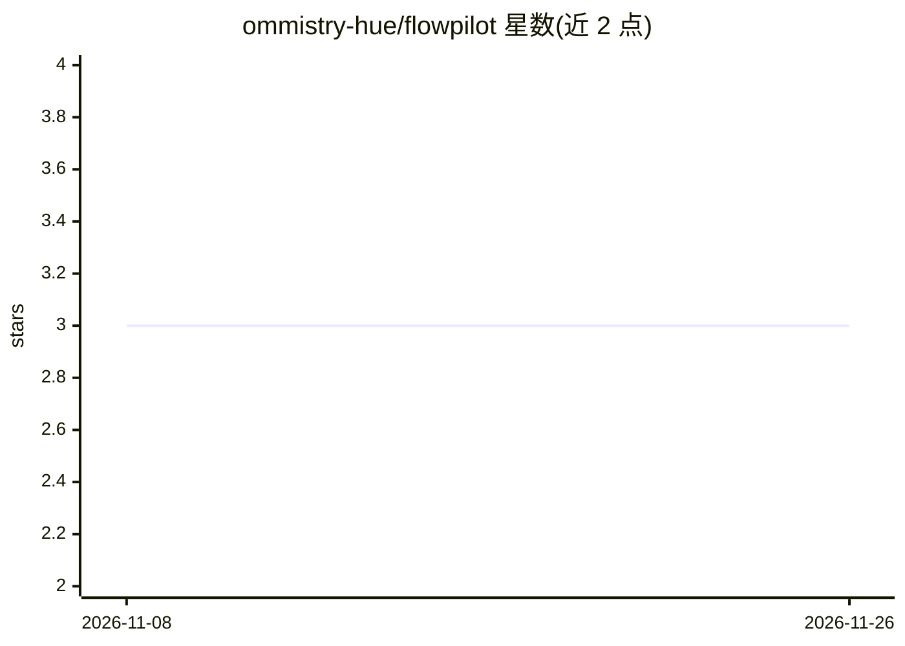

# ommistry-hue/flowpilot

⭐ 3 · TypeScript · Apache-2.0 · 推送 2026-11-24 · [GitHub](https://github.com/ommistry-hue/flowpilot) · [官网](https://github.com/ommistry-hue/flowpilot) · 个人维护

**面向 .NET 开发者的自托管可视化工作流自动化平台**

自托管的工作流自动化平台：在浏览器中拖拽设计工作流，或用自然语言让 LLM 生成流程图。每步执行检查点写入 SQLite/PostgreSQL，支持崩溃后恢复、人工审批挂起与指数退避重试。单个 .NET 10 进程，可通过 Docker 镜像运行，或以 AddFlowPilot() 嵌入已有 ASP.NET Core 应用。内置触发器（webhook/cron/事件）、secrets 管理、Jint 沙箱 JavaScript 表达式与 C# 插件 SDK。

## 筛选速览

| 维度 | 判定 | 备注 |
|---|---|---|
| AI 角色 | `ai-enhanced` | 去掉 AI 部分产品仍成立 |
| 许可风险 | `permissive` | Apache-2.0 |
| 部署形态 | `desktop` | 安装包/桌面程序 |
| 模型依赖 | local-ok | 支持本地模型 |
| 硬件要求 | — | 无带数字的原话,不猜 |
| 安装摩擦 | `low` | 无编译、无系统依赖或容器化 |
| 成熟度 | — | 结构信号不足 |

## 能力要点

- 浏览器可视化设计器，支持 AI 从提示词生成/编辑工作流
- 持久化执行：每步检查点入 SQLite/PostgreSQL，重启后恢复
- 人工审批节点与 API，支持长等待 bookmark 机制
- C# 插件 SDK 与嵌入式引擎（AddFlowPilot()）

## 适用场景

- 为业务流程搭建带人工审批节点的自动化工作流
- 在 ASP.NET Core 应用中嵌入持久化工作流引擎
- 通过 webhook 与 cron 触发系统集成内部服务
- 用自然语言描述快速生成工作流草稿

## 场景标签

`工作流自动化` · 领域:效率与自动化

## 证据(README 行号)

> L25: FlowPilot is a workflow automation platform you run yourself. Draw workflows in the browser, or describe them in pl
> L68: - **AI built in.** Generate or edit a whole workflow from a prompt. Call an LLM from any workflow with the `ai.prom
> L71: - **Embeddable.** `FlowPilot.Core` is a library. Add the engine to an existing ASP.NET Core app with one call.

## 星数曲线

2026-11-08 3 → 2026-11-26 3（+0）

---
*卡片 v1 · prompt 1.4 · 生成 2026-11-21 · 置信度 high · 依据 README sha `5ff8fee74cbc` · [字段定义](../../DATASET.md)*
