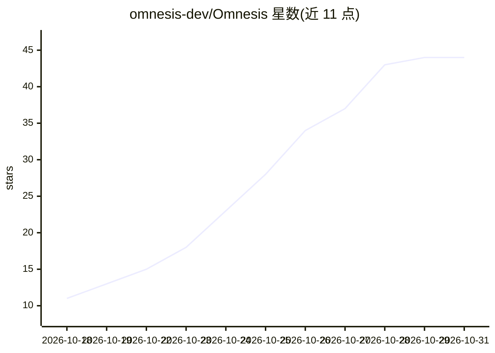

# omnesis-dev/Omnesis

⭐ 44 · TypeScript · AGPL-3.0 · 推送 2026-10-30 · [GitHub](https://github.com/omnesis-dev/Omnesis) · [官网](https://omnesis.dev) · 组织维护

**自托管个人全数据索引与搜索系统：聚合40+来源供混合检索与问答**

运行在用户自有机器（macOS/Linux）上的个人数据聚合系统：将邮件、消息、笔记、日历、文件、健康与财务等 40+ 来源同步到一个统一索引，提供关键词+语义混合搜索、结构化过滤与 SQL 查询，并通过人名图与引用图跨来源关联同一人或同一文档链。内置只读沙箱 agent 从个人数据回答问题并附引用，也支持经 MCP（OAuth、分级访问权限）接入 Claude、ChatGPT、Codex 等外部 agent。数据不经任何 Omnesis 服务，支持静态加密与 Docker 部署；处于 alpha 阶段，不支持 Windows，Apple 来源需 Mac collector。

## 筛选速览

| 维度 | 判定 | 备注 |
|---|---|---|
| AI 角色 | `ai-native` | 本体是模型或模型工具 |
| 许可风险 | `viral` | AGPL-3.0 |
| 部署形态 | `library` | 以包/库形式分发 |
| 模型依赖 | — | README 未给出锁定关系 |
| 硬件要求 | — | 无带数字的原话,不猜 |
| 安装摩擦 | `low` | 无编译、无系统依赖或容器化 |
| 成熟度 | `idea` | |

## 能力要点

- 40+ 个人数据源同步进一个本地搜索索引
- 关键词+语义混合搜索，含结构化过滤与 SQL
- 跨来源人名图与引用图关联
- 内置只读沙箱 agent，或经 MCP/OAuth 分级接入外部 agent

## 适用场景

- 把散落在各平台的个人数据统一成一个可搜索的索引
- 用自然语言向自己的邮件、笔记、健康数据提问并获得带引用的回答
- 在自有设备上保留数据的前提下做个人知识管理与审计

## 场景标签

`知识库管理` `语义搜索` · 领域:知识与检索

## 证据(README 行号)

> L15: Omnesis syncs your email, messages, notes, calendars, tasks, contacts, files, health data, finances, meetings, phot
> L19: On top sits a built-in **agent**, in the web portal and the iOS and Android apps, that answers questions from your 

## 星数曲线

2026-10-18 11 → 2026-10-31 44（+33）

---
*卡片 v1 · prompt 1.4 · 生成 2026-10-26 · 置信度 high · 依据 README sha `8278340522a6` · [字段定义](../../DATASET.md)*
