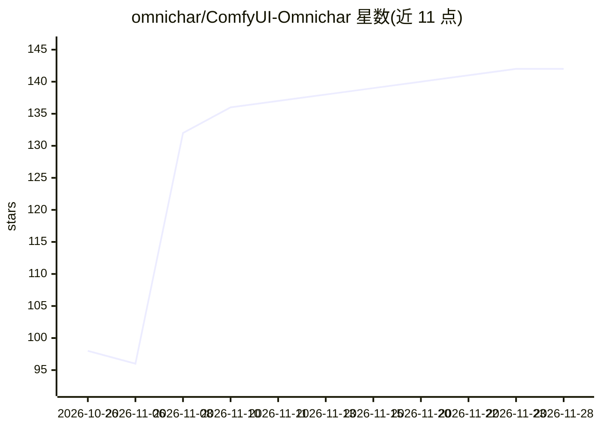

# omnichar/ComfyUI-Omnichar

⭐ 142 · Python · GPL-3.0 · 推送 2026-11-15 · [GitHub](https://github.com/omnichar/ComfyUI-Omnichar) · [官网](https://omnichar.org) · 组织维护

**让 ComfyUI 用户跨模型保持角色一致的 .char 节点**

ComfyUI 的 .char 角色格式官方集成节点：.char 文件封装角色的参考图、锁定描述、可选 LoRA 与语音片段。提供 Load/Decode/Encode 等节点，把角色转成 conditioning、参考图列表或 latent，接入 FLUX.2、MiniMax H3、Krea 2 等模型的图像与视频工作流；角色可在本地 Studio、Cloud 或节点内构建，带许可证密钥机制支持授权角色。另提供独立 Python 库 omnichar-sdk（Apache-2.0）。安装需已有 ComfyUI 与 Python 3.10+。

## 筛选速览

| 维度 | 判定 | 备注 |
|---|---|---|
| AI 角色 | `ai-ecosystem` | LLM/agent 周边工具 |
| 许可风险 | `viral` | GPL-3.0 |
| 部署形态 | `library` | 以包/库形式分发 |
| 模型依赖 | — | README 未给出锁定关系 |
| 硬件要求 | — | 无带数字的原话,不猜 |
| 安装摩擦 | `low` | 无编译、无系统依赖或容器化 |
| 成熟度 | — | 结构信号不足 |

## 能力要点

- .char 文件封装参考图、描述、LoRA 与语音，跨模型复用
- Decode Character 输出 conditioning/参考图/latent 适配不同模型的引用方式
- 语音片段按对话检测自动发送给 MiniMax H3（auto/never/always）
- 支持云授权角色：许可证内嵌于 .char，需输入密钥

## 适用场景

- 在 ComfyUI 工作流中让同一角色在图像/视频模型间保持一致
- 给角色配置声音生成说话视频
- 使用或分发带授权的角色文件

## 场景标签

`图像生成` `视频生成` · 领域:内容生成

## 证据(README 行号)

> L5: Official `.char` integration for ComfyUI. Build a character once and keep the same face, body,
> L39: - **Python Library**: Omnichar's standalone package for `.char` integration, no dependencies

## 星数曲线

2026-10-26 98 → 2026-11-28 142（+44）

---
*卡片 v1 · prompt 1.4 · 生成 2026-11-27 · 置信度 high · 依据 README sha `a5b23cc5fb24` · [字段定义](../../DATASET.md)*
