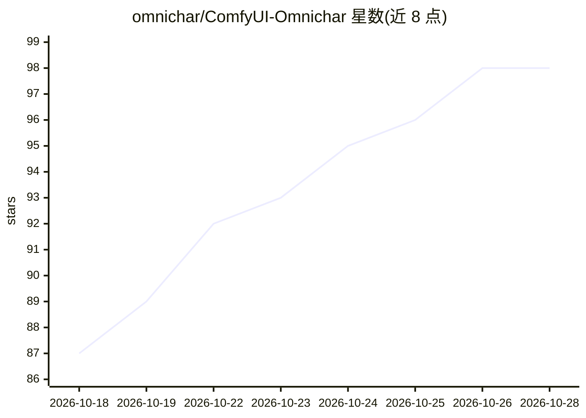

# omnichar/ComfyUI-Omnichar

⭐ 98 · Python · GPL-3.0 · 推送 2026-10-09 · [GitHub](https://github.com/omnichar/ComfyUI-Omnichar) · [官网](https://omnichar.org) · 组织维护

**ComfyUI 节点包：用 .char 格式跨模型保持角色一致性**

Omnichar 官方的 ComfyUI 自定义节点集，读取与生成 .char 角色文件：文件内含参考图、锁定描述与可选的已训练 LoRA，可接入 FLUX.2 dev、FLUX.2 klein 9B/4B、MiniMax H3、Krea 2 等模型，并在 MiniMax H3 上携带语音片段（约 30 秒，按提示词是否含对白决定是否发送）。提供 Load/Decode/Encode Character 等 7 个节点，支持 CLIP conditioning 直出与参考槽位保持顺序。另有独立的 omnichar-sdk Python 包（Apache-2.0），可在 ComfyUI 之外集成。

## 筛选速览

| 维度 | 判定 | 备注 |
|---|---|---|
| AI 角色 | `ai-ecosystem` | LLM/agent 周边工具 |
| 许可风险 | `viral` | GPL-3.0 |
| 部署形态 | `library` | 以包/库形式分发 |
| 模型依赖 | — | README 未给出锁定关系 |
| 硬件要求 | — | 无带数字的原话,不猜 |
| 安装摩擦 | `low` | 无编译、无系统依赖或容器化 |
| 成熟度 | — | 结构信号不足 |

## 能力要点

- .char 文件含参考图、描述与可选 LoRA，跨 FLUX.2 / MiniMax H3 / Krea 2 等模型复用
- Encode Character 节点可从 face/body/clothes 各 3 槽位现场构建角色
- 语音片段存入角色，MiniMax H3 对白提示时自动发送
- omnichar-sdk 独立包 Apache-2.0，无依赖，可在任意环境读取 .char

## 适用场景

- 在 ComfyUI 中为图像/视频生成保持同一角色的脸、身体与服装
- 把 Omnichar Studio 构建的角色文件接入现有工作流
- 为 MiniMax H3 生成带一致语音的对白视频

## 场景标签

`图像生成` `视频生成` · 领域:内容生成

## 证据(README 行号)

> L5: Official `.char` integration for ComfyUI. Build a character once and keep the same face, body,
> L43: - ComfyUI
> L74: ## Nodes

## 星数曲线

2026-10-18 87 → 2026-10-28 98（+11）

---
*卡片 v1 · prompt 1.4 · 生成 2026-10-23 · 置信度 high · 依据 README sha `80fe83addb68` · [字段定义](../../DATASET.md)*
