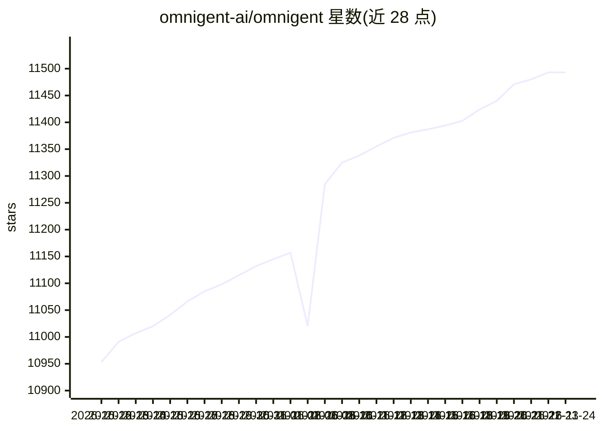

# omnigent-ai/omnigent

⭐ 11,493 · Python · Apache-2.0 · 推送 2026-11-22 · [GitHub](https://github.com/omnigent-ai/omnigent) · [官网](https://omnigent.ai) · 组织维护

**统一编排多个 AI 编码 agent 的开源元框架**

Omnigent 为 Claude Code、Codex、Cursor 等多种 agent 运行时提供统一的编排层：同一会话内混合运行多种 harness，跨终端/浏览器/手机/桌面应用同步会话状态，并支持实时协作（共享、共同驾驶、fork 会话）。通过策略机制在风险操作前暂停审批、限制支出与工具访问，支持在 Modal、E2B、Kubernetes 等云端沙箱运行 agent。安装需要 Python 3.12+、uv、git，Windows 原生模式为功能受限的降级模式。当前状态为 alpha。

## 筛选速览

| 维度 | 判定 | 备注 |
|---|---|---|
| AI 角色 | `ai-ecosystem` | LLM/agent 周边工具 |
| 许可风险 | `permissive` | Apache-2.0 |
| 部署形态 | `self-host` | docker 或自建部署 |
| 模型依赖 | local-ok | 支持本地模型 |
| 硬件要求 | — | 无带数字的原话,不猜 |
| 安装摩擦 | `low` | 无编译、无系统依赖或容器化 |
| 成熟度 | `idea` | |

## 能力要点

- 同一会话混合运行多种 agent harness（YAML 自定义 agent）
- 会话跨终端/浏览器/手机/桌面应用同步，支持团队实时协作
- 策略治理：风险操作审批、支出上限、工具访问限制
- 支持 Modal/E2B/Kubernetes 等云端沙箱运行

## 适用场景

- 在一处界面统一管理多个不同的编码 agent
- 团队成员共享会话、实时观看 agent 工作
- 在云端沙箱运行 agent 而不占用本地机器
- 为 agent 设置审批与支出限制策略

## 场景标签

`Agent 框架` `多智能体` · 领域:Agent 开发

## 证据(README 行号)

> L3: ### The open-source meta-harness for all your AI agents.
> L5: Omnigent is an open-source **meta-harness** that gives you a common orchestration layer over Claude Code, Codex, Cur
> L49: - **🛡️ Govern your agents.** Create

## 星数曲线

2026-10-22 10,953 → 2026-11-24 11,493（+540）

---
*卡片 v1 · prompt 1.4 · 生成 2026-11-22 · 置信度 mid · 依据 README sha `88710e13625d` · [字段定义](../../DATASET.md)*
