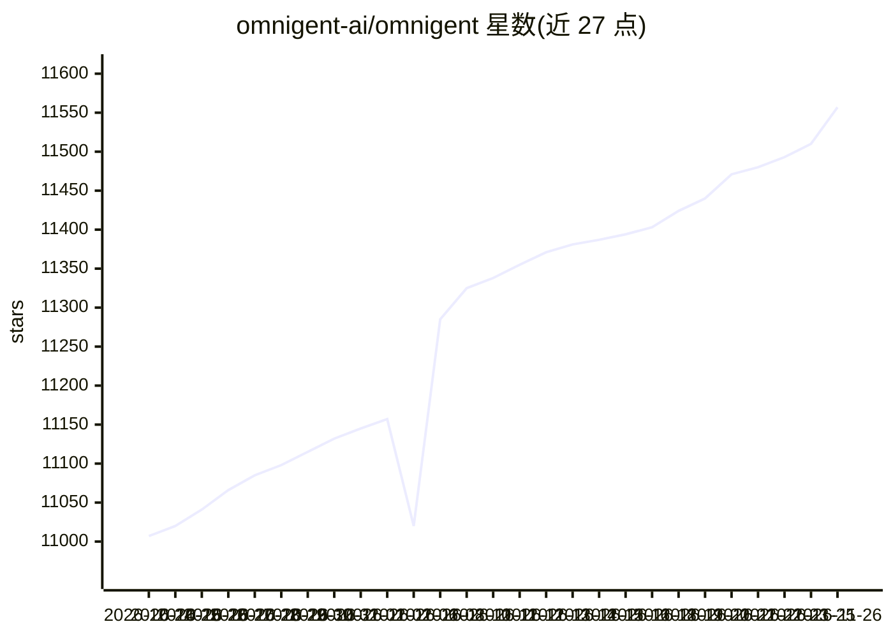

# omnigent-ai/omnigent

⭐ 11,557 · Python · Apache-2.0 · 推送 2026-11-25 · [GitHub](https://github.com/omnigent-ai/omnigent) · [官网](https://omnigent.ai) · 组织维护

**为开发者统一编排多种 AI 编码 agent 的元编排层**

开源 meta-harness，在 Claude Code、Codex、Cursor 等多种 harness 之上提供统一编排层：同一会话中混用/替换 agent 而无需重写，支持 YAML 定义自定义 agent、策略审批、消费限额、工具范围限制与沙箱隔离。会话可在终端、浏览器、手机间跟随同步，支持共享会话协作与 fork。云端沙箱支持 Modal、E2B、Kubernetes、Databricks 等后端。提供 CLI、web UI 与 macOS 桌面应用；状态为 alpha，需 Python 3.12+，Windows 仅降级模式。

## 筛选速览

| 维度 | 判定 | 备注 |
|---|---|---|
| AI 角色 | `ai-ecosystem` | LLM/agent 周边工具 |
| 许可风险 | `permissive` | Apache-2.0 |
| 部署形态 | `self-host` | docker 或自建部署 |
| 模型依赖 | — | README 未给出锁定关系 |
| 硬件要求 | — | 无带数字的原话,不猜 |
| 安装摩擦 | `low` | 无编译、无系统依赖或容器化 |
| 成熟度 | `idea` | |

## 能力要点

- 同一会话混用多种 agent harness（Claude Code/Codex/Cursor 等）及 YAML 自定义 agent
- 策略治理：审批暂停、消费上限、工具范围限制，作用于服务器/单 agent/单会话
- 会话跨终端/浏览器/手机实时同步，支持共享协作与 fork
- 云端一次性沙箱（Modal/E2B/Kubernetes/Databricks 等）与 Linux bwrap / macOS seatbelt 本地沙箱

## 适用场景

- 在多个 agent 之间分工协作，让一个 agent 审查另一个的产出
- 通过策略审批和消费上限管控团队的 agent 使用
- 从手机或浏览器接续在终端启动的 agent 会话
- 在云端沙箱运行 agent 而不占用本地笔记本

## 场景标签

`Agent 框架` `多智能体` `编码 Agent` · 领域:Agent 开发

## 证据(README 行号)

> L3: ### The open-source meta-harness for all your AI agents.
> L5: Omnigent is an open-source **meta-harness** that gives you a common orchestration layer over Claude Code, Codex, Cur
> L49: - **🛡️ Govern your agents.** Create

## 星数曲线

2026-10-24 11,007 → 2026-11-26 11,557（+550）

---
*卡片 v1 · prompt 1.4 · 生成 2026-11-26 · 置信度 mid · 依据 README sha `fe5e87072546` · [字段定义](../../DATASET.md)*
