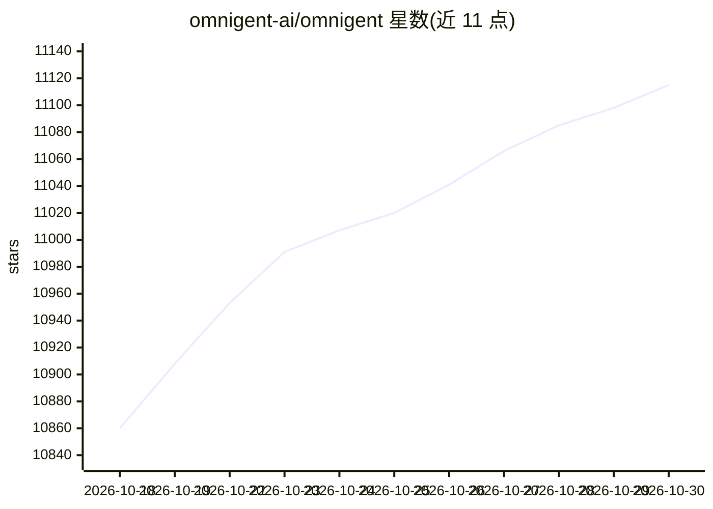

# omnigent-ai/omnigent

⭐ 11,115 · Python · Apache-2.0 · 推送 2026-10-29 · [GitHub](https://github.com/omnigent-ai/omnigent) · [官网](https://omnigent.ai) · 组织维护

**多 AI coding agent 统一编排与治理的开源框架**

开源的 AI agent 编排层与 meta-harness：在同一会话中混合运行 Claude Code、Codex、Cursor、OpenCode、Hermes、Pi 及 YAML 定义的自定义 agent，支持切换 harness 无需重写。提供跨设备会话同步（终端/浏览器/手机/macOS 桌面应用）、策略治理（审批、限额、工具限制）、操作系统级沙箱（bwrap/seatbelt/Job Object）以及 Modal、E2B、Kubernetes 等十余种云沙箱后端。模型接入支持 API key、Claude/ChatGPT 订阅或兼容网关。项目自述状态为 alpha。

## 筛选速览

| 维度 | 判定 | 备注 |
|---|---|---|
| AI 角色 | `ai-ecosystem` | LLM/agent 周边工具 |
| 许可风险 | `permissive` | Apache-2.0 |
| 部署形态 | `self-host` | docker 或自建部署 |
| 模型依赖 | locked-api |  |
| 硬件要求 | — | 无带数字的原话,不猜 |
| 安装摩擦 | `low` | 无编译、无系统依赖或容器化 |
| 成熟度 | `idea` | |

## 能力要点

- 同一会话混合编排多家 coding agent 与 YAML 自定义 agent
- 策略治理：风险操作审批、花费上限、工具限制
- 操作系统级沙箱隔离（Linux bwrap / macOS seatbelt / Windows Job Object）
- 十余种云沙箱后端（Modal/E2B/Kubernetes/Databricks 等）

## 适用场景

- 在终端、浏览器或手机上持续跟进多个 coding agent 的会话
- 让不同厂商的 agent 互相审查代码或分工并行开发
- 对 agent 的敏感操作和花费设置统一的治理策略

## 场景标签

`Agent 框架` `多智能体` · 领域:Agent 开发

## 证据(README 行号)

> L3: ### The open-source meta-harness for all your AI agents.
> L5: Omnigent is an open-source **meta-harness** that gives you a common orchestration layer over Claude Code, Codex, Cur
> L24: - **🤖 Supervise multiple agents.** Mix Claude Code, Codex, Cursor, OpenCode,

## 星数曲线

2026-10-18 10,860 → 2026-10-30 11,115（+255）

---
*卡片 v1 · prompt 1.4 · 生成 2026-10-20 · 置信度 mid · 依据 README sha `62b063b512ee` · [字段定义](../../DATASET.md)*
