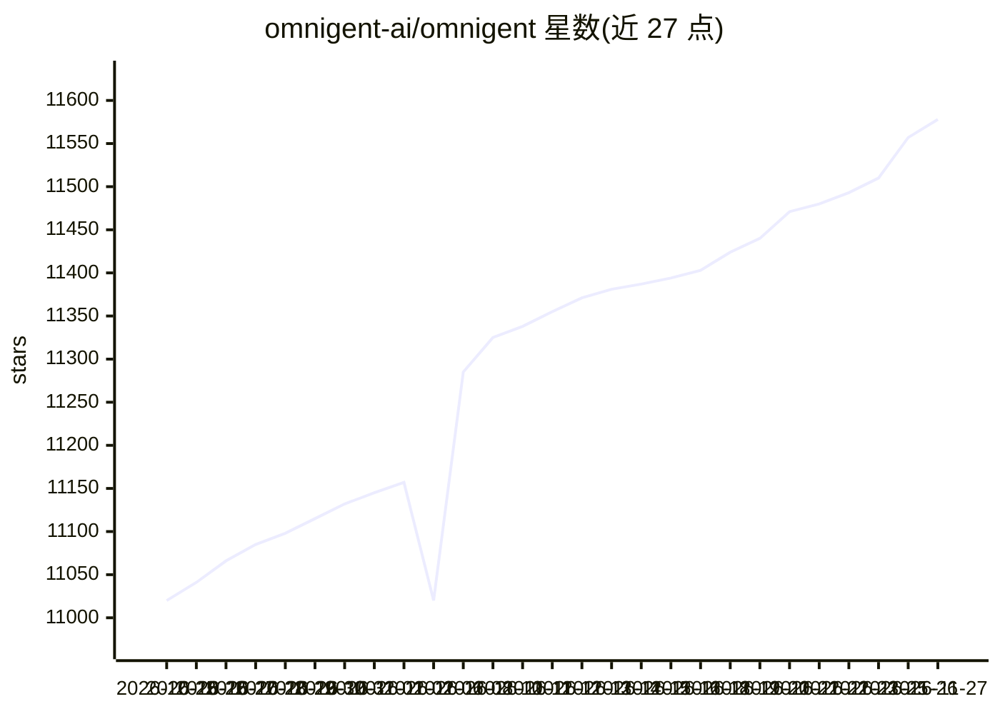

# omnigent-ai/omnigent

⭐ 11,578 · Python · Apache-2.0 · 推送 2026-11-26 · [GitHub](https://github.com/omnigent-ai/omnigent) · [官网](https://omnigent.ai) · 组织维护

**AI agent 元编排框架：统一调度多种 coding agent**

开源 meta-harness，为 Claude Code、Codex、Cursor 等多种 coding agent 提供统一编排层：可在同一会话中混合运行多个 agent 与自定义 YAML agent，切换 harness 无需重写；提供策略治理（风险动作审批、花费上限、工具限制）与沙箱隔离（bwrap/seatbelt、多种云端沙箱后端）；会话可跨终端、浏览器、手机、桌面应用实时同步协作。当前状态为 alpha，Apache 2.0 许可，需 Python 3.12+。

## 筛选速览

| 维度 | 判定 | 备注 |
|---|---|---|
| AI 角色 | `ai-ecosystem` | LLM/agent 周边工具 |
| 许可风险 | `permissive` | Apache-2.0 |
| 部署形态 | `self-host` | docker 或自建部署 |
| 模型依赖 | — | README 未给出锁定关系 |
| 硬件要求 | — | 无带数字的原话,不猜 |
| 安装摩擦 | `low` | 无编译、无系统依赖或容器化 |
| 成熟度 | `idea` | |

## 能力要点

- 一个会话中混合运行多种 agent 与 YAML 自定义 agent
- 策略治理：审批、花费上限、工具限制，作用于服务器/单 agent/单会话
- 云端沙箱后端：Modal、Daytona、E2B、Kubernetes、Databricks 等
- 会话跨终端/浏览器/手机/桌面应用实时同步

## 适用场景

- 让多个 coding agent 在同一任务中分工协作或互相审查
- 限制 agent 的工具与花费、在执行风险动作前要求人工审批
- 在手机或浏览器上继续并监督终端里运行的 agent 会话

## 场景标签

`Agent 框架` `多智能体` · 领域:Agent 开发

## 证据(README 行号)

> L5: Omnigent is an open-source **meta-harness** that gives you a common orchestration layer over Claude Code, Codex, Cur
> L49: - **🛡️ Govern your agents.** Create
> L51:  before risky actions, cap spend, or limit which tools an agent reaches.

## 星数曲线

2026-10-25 11,020 → 2026-11-27 11,578（+558）

---
*卡片 v1 · prompt 1.4 · 生成 2026-11-27 · 置信度 mid · 依据 README sha `d212e5918170` · [字段定义](../../DATASET.md)*
